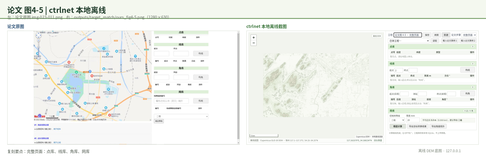
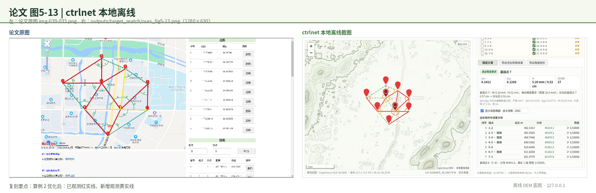
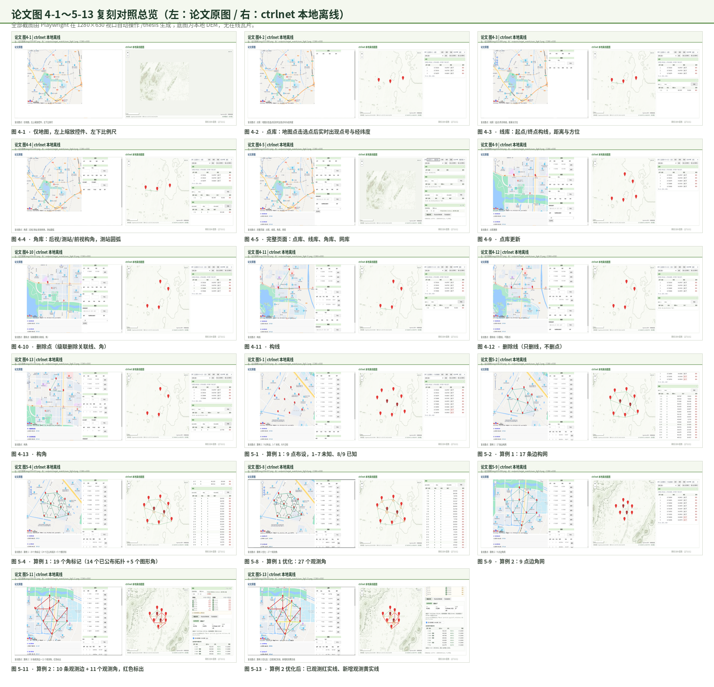

# ctrlnet — 平面/高程控制网精度估算与优化设计（MVP 计算核心）

`ctrlnet` 是一个纯 Python 的平面/高程控制网**设计态（先验）**计算核心，并附带
可选的本地只读网页地图（FastAPI + 离线 Leaflet），
实现 [`docs/redesign_plan.md`](docs/redesign_plan.md) 中“平面控制网精度估算与优化
设计”重设计方案的 MVP、P1–P5 部分能力与 C1–C4 增量：

- 平面网：距离、方向、角度、二维 GNSS 基线、坐标伪观测；
- GNSS 三维基线网：WGS84 大地坐标/ECEF/局部 ENU、3×3 基线协方差、固定/最小
  约束、水平/垂直/三维精度、基线相对精度与 `r_i`/MDB；
- GNSS + 地面边角 + 水准联合平差（局部 ENU 切平面近似）；
- 高程异常 ζ=h−H 的常数/平面拟合、参数协方差与残差，可选 EGM96 格网插值；
- 平面基准：固定基准、加权基准、自由网/最小约束与秩亏诊断；
- 设计矩阵解析偏导、Cholesky 白化、SVD 求协方差；
- 点位中误差、标准/置信误差椭圆、边长相对精度；
- 可靠性：多余观测分量 `r_i`、MDB、外部可靠性、w 检验；
- 模拟观测与实测平差：按先验 σ 生成距离/方向/角度/GNSS 2D/水准观测，可注入
  k·σ 粗差；平面网高斯-牛顿迭代、水准网线性迭代；
- 粗差探测与稳健估计：Baarda w 检验与迭代 snooping、Pope τ 检验、χ² 整体检验、
  Huber 与 IGG-III 迭代重加权最小二乘；
- 水准/高程网：1D 高程参数、固定/加权/自由网基准、水准测段与闭合环；
- 三角高程：斜距/平距 + 天顶距、仪器高/目标高、曲率折光改正与误差传播；
- DEM 地形：GeoTIFF 读取、双线性采样、剖面、曲率/折光通视、晕渲与等高线；
- 通视约束网：只用通视的距离/角度边做平面平差，并把 95% 误差椭圆叠加到晕渲图；
- 本地网页地图：FastAPI + 包内离线 Leaflet，晕渲/等高线/控制点/观测线/误差椭圆与两点剖面；
- 六参数仿射影像配准：最小二乘、逐点残差/RMS、`.pgw`/`.tfw` 世界文件与网页 4 点配准演示；
- 方案对比、贪心/局部搜索/精确分支定界观测优化（A/D/E/max_mp/最弱边），
  支持观测成本 + 测站首次使用固定成本，并提供 SciPy MILP 线性代理近似；
- 第 13 节黄金算例的精度与可靠性回归；
- 生成网图、对比图、可靠性图、优化过程图、水准路线图、地形图、CSV 与中文报告；
- SQLite 工程库（`store.py`）：`projects / points / observations / scenarios /
  snapshots / results`，方案版本号与父方案、规范化 JSON 快照 + SHA-256
  `input_hash`、按哈希缓存计算结果；
- 投影归算（`projection.py`）：高斯/UTM 尺度因子、子午线收敛角、grid↔ground
  高程归算、跨带/中央子午线偏离检查；复用 `thesis.py` 的 CGCS2000/WGS84
  椭球与 Krüger n⁶ 系数；
- 单工程 zip 工程包（`package.py`）：`manifest.json` + SQLite + 小资源，
  逐文件 SHA-256、格式版本、快照哈希与依赖清单；导出/校验/导入 CLI，
  样例包约 324 KiB（大 DEM 仍只引用路径）；
- 设计报告（`reportgen.py`）：工程概况、点/观测清单、先验精度模型、基准、
  点位精度与误差椭圆、边相对精度、可靠性、方案对比、优化建议、通视结果与图表，
  输出 Markdown / 自包含 HTML / 可选 DOCX（pandoc）；
- 网页方案切换与报告下载：第 13 节基准/增补、DEM 全部通视边/优化方案，
  切换后刷新点、观测、椭圆与统计；`/api/report` 返回 HTML/Markdown/DOCX。
- 论文第 3–5 章约定（`thesis.py`）：CGCS2000/WGS84 3° 带高斯正反算、
  椭球面距离/方位、表 3-1 等级、σS=a+bS 线性测距先验、测角网 P=I 的
  mm²/(″)² 精度估算、误差椭圆、坐标/角度拓扑文本导入导出；
- 论文算例复现（`thesis_examples.py`）：算例 1 的 Qxx/Qyy/最弱点、图 5-7
  边长分母反推，算例 2 的近似 Qxx/Qyy；网页数据在
  `data/sample/thesis_example1.json`、`thesis_example2.json`。

数值约定：内部长度/高程单位为米、角度/方向为弧度；显示时距离/高差用 mm，
角度用角秒。DEM 计算使用米制局部 UTM 坐标。项目以设计阶段先验精度估算为主，
C1 起补充实测模拟观测的平差、粗差探测与稳健估计；C3 起支持 GNSS 三维基线
向量网、局部 ENU 联合平差与高程异常平面拟合（可选 EGM96 格网插值），但
高程异常仍是**局部近似**，不是全国/高精度 geoid 模型。C4 起提供单工程只读
SQLite 持久化、快照/结果缓存、报告下载与 zip 工程包导出/回读；E1 补齐投影
尺度/收敛角/grid-ground/跨带检查，但多工程编辑、并发写入与权限管理仍未实现。

## 1. 与 docs 方案的对应关系

| 重设计方案 | 本仓库实现 | 状态 |
|---|---|---|
| §5.3 基准与秩：固定/加权/最小约束/自由网 | `datum.py`、`adjustment.py`；SVD 秩、零空间诊断、伪逆 | ✅ MVP |
| §5.4 可靠性：`Qv`、`R`、`r_i`、MDB、外部可靠性、w 检验 | `reliability.py`；λ0 用 `statistics.NormalDist` 精确计算，默认 7.849 | ✅ MVP |
| §5.10 粗差探测与稳健估计：模拟观测、w/τ/χ²、Huber/IGG-III | `robust.py`；高斯-牛顿、迭代 snooping、IRLS、MAD 尺度 | ✅ P1/C1 |
| §5.5 精度：`mp`、误差椭圆、边长相对精度、最弱点/边 | `precision.py`；标准椭圆与 95% 椭圆，`k=sqrt(-2ln0.05)` | ✅ MVP |
| §5.6 优化：贪心、预算/阈值、A/D/E 最优、最弱边、MICP/MILP | `optimize.py`；贪心 + 1 换 1 局部搜索；≤20 候选的分支定界/穷举精确解；SciPy MILP 线性代理 | ✅ C2 |
| §5.9 水准/高程网：路线/环、`σ_km`、固定/加权/自由基准、`r_i`/MDB | `leveling.py`；1D 设计矩阵、SVD、伪逆、相对高差精度 | ✅ P1/B1 |
| §5.9.5 三角高程：斜距/平距、天顶距、曲率折光、误差传播 | `leveling.py`；解析偏导与逐项误差贡献 | ✅ P1/B1 |
| §5.2 坐标与投影：局部 UTM、经纬度↔米制转换、尺度/收敛角 | `projection.py`、`thesis.py`、`terrain.py`；高斯/UTM 尺度、γ、grid/ground、跨带检查 | ✅ P1/E1 |
| §5.7 DEM 通视：双线性采样、剖面、曲率/折光、四态判定 | `terrain.py`；`DEM`、`profile`、`intervisibility` | ✅ P1/B2 |
| §5.7 地形渲染：晕渲、等高线 | `terrain.py`；`hillshade`、`contours` | ✅ P1/B2 |
| §5.2.7 地图/地形图配准：6 参数仿射、控制/检查点、残差 RMS | `registration.py`；`register_affine`/`register_image`、世界文件 | ✅ P1/B3 |
| §4 数据模型：Project/Point/Observation/Scenario/Snapshot/Result | `store.py`；SQLite 六表、方案版本/父方案、规范化快照与结果缓存 | ✅ C4（单工程只读） |
| §4 工程包 zip/manifest、依赖与哈希校验 | `package.py`；`manifest.json`、SQLite、小资源、SHA-256、版本/快照校验 | ✅ E1（单工程） |
| §7 接口：图层、剖面、晕渲、配准、报告资源 | `webmap/app.py`；FastAPI `/api/scenarios`、`/api/scenario/{id}`、`/api/report` 等 | ✅ C4（只读单工程） |
| §8 界面：地图、图层、属性、剖面图、方案切换、报告 | `webmap/static/`；Leaflet `CRS.Simple` + SVG 剖面 + 方案下拉 + 报告按钮 | ✅ C4（演示级） |
| §10.2 第 13 节黄金回归 | `examples.py`、`tests/test_section13.py` | ✅ 全部通过 |
| §10.3 水准模块验证：闭合差、秩 1、`Σr_i`、三角高程公式 | `tests/test_leveling.py` | ✅ 全部通过 |
| §10.3 DEM 模块验证：平面/斜面/山脊、曲率折光、插值、晕渲 | `tests/test_terrain.py` | ✅ 全部通过 |
| 数据模型（点、观测、网、方案） | `model.py`；不可变计算入口，直接构造 `Network`/`Scenario` | ✅ MVP |
| 工程持久化 / 快照 / 结果缓存 | `store.py`；SQLite、`input_hash`、`get_or_compute_result` | ✅ C4 |
| 工程包导出 / 回读 / 校验 | `package.py`；zip + manifest、逐文件 SHA-256、快照回读、CLI | ✅ E1 |
| 报告与图件 | `report.py`（文本表）、`reportgen.py`（Markdown/HTML/DOCX）、`plot.py`、`scripts/run_demo.py` | ✅ C4 |
| 地图/离线底图/MBTiles、扫描图配准 | `webmap/` DEM/扫描图叠加；多项式/TPS、离线 MBTiles/XYZ 已实现；RPC/MVT 未实现 | ⚠️ 部分（B3/E3） |
| GUI、工程树、地图选点、交互编辑 | 本地只读网页地图：图层开关、点/线点击、两点剖面；无工程树与编辑 | ⚠️ 部分（B3/E3） |
| FastAPI/数据库/工程包/快照持久化 | `store.py` + `package.py` + `webmap/app.py`：SQLite 单工程、快照/结果缓存、zip 工程包；WAL 并发写、轻量迁移与行级审计（E5）；多工程编辑界面未实现 | ✅ C4/E1（单工程） |
| 投影归算全链路（投影尺度、子午线收敛角、跨带） | `projection.py`：复变 n⁶ 尺度/γ、grid/ground、跨带告警；`scripts/run_projection_demo.py` | ✅ E1 |
| §5.2 GNSS 三维 ECEF/ENU、局部切平面 | `gnss.py`；WGS84 自实现转换、ENU 原点与旋转 | ✅ C3 |
| §5.8 GNSS 基线网：3×3 VCV、固定/最小约束、基线相对精度 | `gnss.py`；ECEF 平差、ENU 基线旋转、Cholesky 白化、复用可靠性 | ✅ C3 |
| §5.8/§5.9 联合平差：GNSS + 距离/角度 + 水准 | `gnss.py`；同一 3D 参数集、局部 ENU、ζ 改正 | ✅ C3（局部近似） |
| §5.9.4 高程异常/geoid、GNSS 大地高→正常高 | `gnss.py`；ζ 常数/平面拟合、参数协方差、可选 EGM96 插值 | ⚠️ 近似（C3）；无高精度 geoid/方差场 |
| 跨基线相关完整 VCV、LandXML | 同时段 3n×3n VCV、块权白化、LandXML 1.2 GPS 子集往返（§27） | ✅ E7（限定子集） |
| 方差分量估计（VCE） | 独立组经典 Helmert 迭代、GNSS/地面边桥接、更新权精度 | ✅ E2b |
| MICP/MILP/Pareto、A/D/E 精确最优 | A/D/E/max_mp/最弱边的精确分支定界（≤20 候选）与 MILP 线性代理；Pareto 前沿未实现 | ✅ C2（小规模精确） |

## 2. 安装

要求 Python ≥ 3.9。运行时依赖 `numpy>=1.24`、`matplotlib>=3.6`；`test` extra
提供 `pytest`、`httpx`、`fastapi`、`pillow`、`rasterio`、`scipy`，`opt` extra
提供 SciPy MILP（`scipy>=1.11`），`demo` extra 提供
`ipykernel`、`nbconvert`、`nbformat`，`terrain` extra 提供 `rasterio`，
`webmap` extra 提供 FastAPI/uvicorn/pillow/rasterio，`e2e` extra 提供
Playwright（无头 Chromium 端到端测试）。

```bash
cd /workspace/ctrlnet-design
python3 -m venv .venv
.venv/bin/pip install -e ".[test,demo,terrain,webmap]"  # 只跑测试可改用 ".[test]"
# 只跑 C2 MILP 演示：.venv/bin/pip install -e ".[opt]"
# 只跑 B2 DEM 演示：.venv/bin/pip install -e ".[test,terrain]"
# 只跑 B3 网页地图：.venv/bin/pip install -e ".[test,webmap]"
# 论文模式端到端测试：.venv/bin/pip install -e ".[e2e]"
```

`pip install -e` 会按 `pyproject.toml` 的 `src` 布局注册 editable 包，测试和演示
都直接 `import ctrlnet`，不再使用 `pythonpath = ["src"]` 或 `sys.path` 回退。
安装后确认导入位置：

```bash
.venv/bin/python -c "import ctrlnet; print(ctrlnet.__file__)"
# 应输出 /workspace/ctrlnet-design/src/ctrlnet/__init__.py
```

## 3. 运行测试

```bash
cd /workspace/ctrlnet-design
.venv/bin/python -m pytest -q
```

当前测试覆盖：

- `tests/test_section13.py`：第 13 节两方案的点 `σE/σN/mp`、椭圆半轴、5 条边 `σs`
  与相对精度分母、`rank=4`、冗余 3/4、`Cx` 对称、`sum r_i=3/4`、可靠性
  `r_i`/MDB/外部影响、距离/方向/角度偏导中心差分、观测顺序与参数顺序不变性；
- `tests/test_rank.py`：缺固定点、单观测待定点、自由网最小约束、加权基准、
  `σ≤0`、NaN、重合点、非法 GNSS 相关系数；
- `tests/test_optimize.py`：贪心加入观测后最大 `mp` 单调不增、预算约束、
  目标阈值、trace 目标单调性；
- `tests/test_exact_optimizer.py`：A/D/E/max_mp/worst_rel 五种准则的分支定界
  与穷举目标值一致、精确解不劣于贪心、预算约束、测站首次使用成本、
  多站成本、方向定向参数、MILP 代理预算/真实目标复算；
- `tests/test_robust.py`：固定种子模拟观测、近似坐标高斯-牛顿收敛、χ² 全局检验、
  无粗差无误判、10σ 粗差被 w 检验与 IGG-III 定位、稳健解接近无粗差解、
  `r_i` 与可控性关系、水准/GNSS 2D/方向观测接口；
- `tests/test_leveling.py`：单路线 `σ_km·sqrt(L)` 与测站数随机模型、闭合环/
  附合路线解析 `Cx`、`Σr_i=冗余数`、无基准秩亏、自由网最小约束、加权高程约束、
  三角高程公式/球气差/斜距-平距等价/误差传播有限差分、`height_type` 属性；
- `tests/test_gnss.py`：大地坐标↔ECEF↔ENU 往返 <1e-6 m、已知 ENU 数值、
  协方差旋转迹/特征值不变、纯 GNSS 网 `Cx` 与解析法方程一致、ENU 基线旋转、
  自由网 3 平移零空间、联合平差加入地面观测后 `Cx` 不变差、ζ 平面参数恢复、
  EGM96 样本插值；
- `tests/test_terrain.py`：平面/斜面 DEM 的双线性插值精确性、剖面端点与步长、
  平地通视、高斯山脊遮挡、提高仪器高后通视、长距离曲率+折光下沉公式、
  `marginal`/NoData `unknown` 四态、晕渲范围 `[0,1]` 与等高线冒烟测试；
- `tests/test_registration.py`：已知仿射精确恢复、加噪 RMS 合理性、少于 3 点/
  共线/非法权值报错、PNG 配准与 `.pgw`/`.tfw` 世界文件往返；
- `tests/test_store.py`：SQLite 保存/读回往返、规范化 JSON、快照确定性、
  同一 `input_hash` 结果缓存、重新打开数据库结果一致、父方案版本、
  修改/追加观测后哈希变化；
- `tests/test_projection.py`：6 组已知点/检查点的尺度因子与收敛角（2e-10 /
  5e-10°）、二阶解析级数与 `gauss_forward` 数值雅可比交叉验证、中央经线
  `m=k0, γ=0`、grid↔ground 5 组往返、3°/UTM 跨带与错误带号告警；
- `tests/test_package.py`：manifest 字段与资源清单、导出→导入→再计算往返
  （点/观测/快照哈希/精度结果一致）、坏 manifest/缺文件/字节数/SHA-256
  不一致/路径穿越拒绝、非空目标目录保护、样例包 ≤2 MiB 且可回读；
- `tests/test_report.py`：Markdown 12 个章节、HTML base64 自包含、方案对比、
  DOCX（有 pandoc 时）、CLI 与未知方案错误；
- `tests/test_webmap.py`：TestClient 覆盖页面、离线 Leaflet 静态资源、
  `/api/project`、`/api/scenarios`、`/api/scenario/{id}`、`/api/layers` 方案切换、
  `/api/report` HTML/MD/DOCX、晕渲 PNG、通视/遮挡剖面、配准演示与叠加 PNG。

预期结果：`221 passed, 1 skipped, 2 xfailed`（pyproj 未安装时跳过 PROJ 对照；
两条 xfail 为论文 19/27 角算例的已知不可复现项；FastAPI TestClient 会提示
一条 httpx 弃用警告，不影响结果）。

## 4. 运行演示

```bash
cd /workspace/ctrlnet-design
.venv/bin/python scripts/run_demo.py
.venv/bin/python scripts/run_leveling_demo.py
.venv/bin/python scripts/run_robust_demo.py     # C1 粗差探测与稳健估计
.venv/bin/python scripts/run_optimizer_compare.py  # C2 贪心/局部/精确/MILP 对比
.venv/bin/python scripts/fetch_dem.py          # 可选：重新下载/裁剪 DEM 小样本
.venv/bin/python scripts/run_terrain_demo.py   # B2 DEM 通视与误差椭圆演示
.venv/bin/python scripts/fetch_egm.py          # 可选：下载/裁剪 EGM96 小样本
.venv/bin/python scripts/run_gnss_demo.py      # C3 GNSS 三维基线网 + 联合平差 + ζ 拟合
.venv/bin/python scripts/make_scan_sample.py   # B3 示例扫描图 + 4 对控制点
.venv/bin/python scripts/build_demo_project.py # C4 生成 SQLite 演示工程
.venv/bin/python scripts/run_projection_demo.py  # E1 尺度/收敛角/grid-ground/跨带表
.venv/bin/python scripts/build_sample_package.py # E1 生成并回读校验 zip 工程包
.venv/bin/python -m ctrlnet.package inspect \
  data/sample/demo_project.ctrlnet.zip            # E1 查看 manifest
.venv/bin/python -m ctrlnet.report \
  --project data/sample/demo_project.sqlite --out outputs/report  # C4 设计报告
.venv/bin/ctrlnet-web                          # 本地网页地图（127.0.0.1:8765）
# 论文模式：http://127.0.0.1:8765/thesis       旧仪表盘：/dashboard
# 或：.venv/bin/python -m ctrlnet.webmap --port 8765
.venv/bin/python scripts/build_thesis_basemap.py  # 可选：重建离线徐州 DEM 底图
.venv/bin/python scripts/test_thesis_e2e.py       # Playwright 无头 E2E
```

`run_demo.py` 打印第 13 节两方案的关键精度/可靠性表，并生成平面网图件、CSV
和中文汇总 `results.md`。`run_leveling_demo.py` 演示 6 点水准网 + 两条三角高程
观测，生成高程点 CSV、中文结果与水准路线图。`run_terrain_demo.py` 在真实
Copernicus GLO-30 子区域上选 7 个高地控制点，做全部 21 对通视分析，并用通视
距离/角度边构网，输出地形图、剖面图、CSV、误差椭圆图与示例工程 JSON。
`run_gnss_demo.py` 用 DEM 演示区 7 点构造 13 条 ENU 三维基线、6 条距离、
4 个水平角与 9 条水准，输出基线/椭圆/垂直精度图、ζ 拟合图、CSV 与中文报告。
`fetch_egm.py` 从公开 PROJ-data 下载 EGM96 15′ 格网并裁剪北京西山小样本。
`make_scan_sample.py` 生成 `data/sample/scan_sample.png` 与 4 对控制点/2 个检查点
元数据；`build_demo_project.py` 把第 13 节两方案与 DEM 全部通视边/优化方案写入
`data/sample/demo_project.sqlite`；`run_projection_demo.py` 输出已知点尺度/收敛角、
UTM 手算近似、grid/ground 往返和跨带检查表；`build_sample_package.py` 生成
`data/sample/demo_project.ctrlnet.zip` 并回读校验 4 个方案的快照哈希与精度结果；
`python -m ctrlnet.report` 生成设计报告；`ctrlnet-web` 启动只绑定回环地址的
网页地图，浏览器访问 `http://127.0.0.1:8765/`，可在左栏切换方案并下载报告。

报告生成命令也支持 `--scenario s13-added`（按 id 或名称）、`--title`、
`--confidence`、`--no-docx` 与 `--basename`；默认输出
`outputs/report/design_report.md`、`.html`、`.docx` 与 `assets/*.png`。

Notebook 与脚本同源（`scripts/build_notebook.py` 从脚本的 `# %%` 单元生成），
已执行版本在 `notebooks/demo.ipynb`，kernel 名为 `ctrlnet-venv`。重新生成并执行：

```bash
.venv/bin/python scripts/build_notebook.py
.venv/bin/python -m ipykernel install --user \
  --name ctrlnet-venv --display-name "ctrlnet (.venv)"
.venv/bin/python -m jupyter nbconvert \
  --to notebook --execute --inplace \
  --ExecutePreprocessor.kernel_name=ctrlnet-venv notebooks/demo.ipynb
```

如果用户 kernelspec 目录不可写（例如只读 HOME），可把 kernel 安装到仓库内被
`.gitignore` 忽略的 `.jupyter/`，执行时通过 `JUPYTER_PATH` 指定：

```bash
.venv/bin/python -m ipykernel install \
  --prefix /workspace/ctrlnet-design/.jupyter \
  --name ctrlnet-venv --display-name "ctrlnet (.venv)"
JUPYTER_PATH=/workspace/ctrlnet-design/.jupyter/share/jupyter \
  .venv/bin/python -m jupyter nbconvert \
  --to notebook --execute --inplace \
  --ExecutePreprocessor.kernel_name=ctrlnet-venv notebooks/demo.ipynb
```

## 5. 输出说明

运行演示后 `outputs/` 包含（该目录是交付物，已提交）：

| 文件 | 内容 |
|---|---|
| `network_ellipses_base.png` | 基准方案网图 + 标准/95% 误差椭圆；椭圆放大 1000× |
| `network_ellipses_added.png` | 增补方案网图 + 标准/95% 误差椭圆；椭圆放大 1000× |
| `scenario_comparison.png` | 基准 vs 增补：各点 `mp`、各边相对精度分母 |
| `reliability_ri.png` | 两方案每条观测的 `r_i`，标出 0.1/0.3/0.5 阈值线 |
| `optimizer_steps.png` | 贪心优化每步最大 `mp` |
| `points.csv` | 各方案点坐标、`σE/σN/mp`、标准/95% 椭圆半轴与方位 |
| `edges.csv` | 边长、`σs`、相对精度分母 |
| `reliability.csv` | `r_i`、MDB、MDB 单位、外部最大分量/向量范数、影响点 |
| `optimizer.csv` | 初始与每步目标值、收益、成本、已选观测 |
| `results.md` | 平面网中文汇总表格与说明 |
| `edge_projection_results.md` | E9 逐边 Simpson 积分、距离改正、弧弦 δ 与独立求积/端点弦长对照 |
| `projection_results.md` | E1 投影归算：已知点 m/γ、解析级数与数值雅可比对照、UTM 手算近似、grid/ground 往返、跨带告警 |
| `leveling_points.csv` | 水准点高程、`σ_H`、基准角色与高程类型 |
| `leveling_results.md` | 水准/三角高程中文结果、闭合环、相对高差与可靠性表 |
| `leveling_network.png` | 水准路线图；点标注 `H`/`σ_H`，线宽按观测权重 `1/σ²` |
| `gnss_network.png` | C3 GNSS 基线网、95% 水平椭圆（放大 10 000×）与各点垂直/三维精度 |
| `geoid_fit.png` | C3 ζ 平面拟合残差、ζ 样本/平面/EGM96 对照 |
| `gnss_results.md` | C3 中文报告：GNSS-only vs 联合平差、点位/基线/可靠性/ζ 拟合 |
| `gnss_results.csv` | C3 长表：点、基线、ζ 控制点的精度/相对精度/`r_i`/MDB/残差 |
| `blunder_detection.png` | C1 粗差探测：迭代前后各观测 `|w|`、临界线、IGG-III 权因子与坐标偏差对比 |
| `robust_results.md` | C1 中文汇总：LS/剔除后 LS/Huber/IGG-III 偏差、snooping 轮次、`r_i` 与可控性 |
| `robust_results.csv` | C1 各方法、各待定点的真值/估值/偏差、异常标签与粗差权因子 |
| `optimizer_comparison.png` | C2 第 13 节网与 DEM 通视网在多预算下的目标值/耗时对比（贪心/局部搜索/精确/MILP） |
| `optimizer_comparison.csv` | C2 每次运行的目标、成本、选中观测、耗时、精确标志与分支节点数 |
| `optimizer_comparison.md` | C2 中文对比表、方法汇总、精确/近似说明与限制 |
| `dem_hillshade_contours.png` | 真实 DEM 晕渲 + 50 m 等高线 + 7 个控制点 + 21 对观测线（绿=通视，红=遮挡） |
| `intervisibility_profiles.png` | 6 条代表性剖面：地形、两端连线、曲率/折光视线、遮挡点与最小净空 |
| `intervisibility.csv` | 全部点对的 `status/visible/min_clearance`、遮挡位置、仪器高/目标高、`k/R`、采样数 |
| `dem_network_ellipses.png` | 只用通视距离/角度边的平面网 95% 误差椭圆叠加在晕渲图上（图题注明放大倍数） |
| `webmap_screenshot.png` | C4 本地网页地图首屏：方案下拉、报告按钮、DEM 晕渲/等高线、全部通视边与椭圆 |
| `webmap_scenario_screenshot.png` | C4 切换到“DEM 优化方案（预算 12）”后：点/观测/椭圆/统计刷新 |
| `webmap_profile_screenshot.png` | B3 网页剖面：P1→P6 地形线、曲率折光视线、遮挡点与净空（历史截图） |
| `report/design_report.md` | C4 设计报告 Markdown：工程概况、点/观测、精度、椭圆、边、可靠性、对比、建议、通视、图表 |
| `report/design_report.html` | C4 自包含 HTML（PNG 以 base64 内嵌，可离线打开） |
| `report/design_report.docx` | C4 DOCX（本机 pandoc 转换；失败自动跳过） |
| `report/assets/design_network.png` | 报告网图与 95% 误差椭圆 |
| `report/assets/design_reliability.png` | 报告可靠性 `r_i` 柱状图与 0.1/0.3 阈值线 |
| `report/assets/design_scenario_comparison.png` | 报告方案对比：各方案最大点位中误差 |
| `report/assets/design_visibility.png` | 报告通视最小净空图（通视绿/遮挡红） |

图件中如检测不到中文字体，会自动退回英文标签，避免方框乱码；本机有 Noto CJK
字体时使用中文。误差椭圆在网图中做了 1000 倍放大，图题中已注明。

网图图例固定在坐标轴右侧外部，点名标签沿网形中心向外放置并位于误差椭圆之外，
不会遮挡点位或椭圆。观测线统一使用深色、线宽 ≥ 1.5：距离为黑色实线，角度为
绿色点划线并在测站处画出小圆弧及带箭头的两条方向线；方向/GNSS 基线分别用橙色
虚线和紫色虚线。`scenario_comparison.png`、`reliability_ri.png` 的图例放在
子图下方外部，`optimizer_steps.png` 的步骤标注放在数据点下方并用细引线连接，
均避免遮挡柱体、折线或数值标签。

## 6. API 简例

```python
from ctrlnet import (
    analyze_precision,
    analyze_reliability,
    section13_base,
    solve,
)

scenario = section13_base()          # A/B 固定，C/D 待定
result = solve(scenario)             # AdjustmentResult
precision = analyze_precision(result)
reliability = analyze_reliability(result)

print(result.rank, result.redundancy, result.condition_number)
for name in ("C", "D"):
    p = precision.points[name]
    print(name, p.sigma_E_mm, p.sigma_N_mm, p.mp_mm)
for row in reliability.records:
    print(row.label, row.r_i, row.mdb_display, row.external_max_mm)
```

自定义网：

```python
from ctrlnet import Angle, Distance, FixedDatum, Network, Point, Scenario, solve

net = Network(
    [
        Point("A", 0.0, 0.0, fixed=True),
        Point("B", 100.0, 0.0, fixed=True),
        Point("C", 0.0, 100.0),
    ],
    [
        Distance("A", "C", a=0.002, b_ppm=2.0),
        Distance("B", "C", a=0.002, b_ppm=2.0),
        Angle("C", "A", "B", sigma_arcsec=1.0),
    ],
)
result = solve(Scenario("小网", net, datum=FixedDatum()))
print(result.rank, result.redundancy, result.point_covariance("C"))
```

## 7. 高程/水准网（B1）

### 7.1 快速开始

```python
from ctrlnet import (
    HeightDifference, LevelingNetwork, LevelingPoint, TrigHeight, solve_leveling,
)

net = LevelingNetwork(
    [
        LevelingPoint("A", 100.000, fixed=True),          # 固定高程基准
        LevelingPoint("B", 101.500),                      # 待定
        LevelingPoint("C", 102.300, sigma_H=0.003),       # 加权约束（3 mm）
    ],
    [
        # σ = σ_km·sqrt(L) = 1.0 mm/√km · sqrt(1.2 km)
        HeightDifference("A", "B", +1.500, length_km=1.2, sigma_per_km_mm=1.0),
        # 也可按测站数：σ = σ_station·sqrt(n)
        HeightDifference("B", "C", +0.800, n_stations=9, sigma_per_station_mm=0.5),
        # 三角高程：斜距 + 天顶距 + 仪器高/目标高 + 曲率折光
        TrigHeight(
            "A", "C", slope_distance=950.0, zenith_deg=89.83,
            instrument_height=1.52, target_height=1.50,
            k=0.13, R=6371000.0, sigma_zenith_arcsec=1.0,
        ),
    ],
)
result = solve_leveling(net)  # 默认 auto：固定点 + 非固定点 sigma_H 加权约束

print(result.rank, result.redundancy, result.Cx)
for name in result.point_order:
    p = result.point_precision(name)      # H / sigma_H / role
    print(name, p.H, p.sigma_mm)
print(result.relative_height("A", "C").sigma_mm)
for row in result.observation_records:    # 不含加权约束行
    print(row.label, row.kind, row.r_i, row.mdb_mm, row.external_max_mm)
```

### 7.2 模型与约定

- 观测方程：`Δh_ij = H_j − H_i + v`；设计矩阵对 `to` 为 `+1`、`frm` 为 `−1`。
- 随机模型优先级：显式 `sigma_mm` > `n_stations + sigma_per_station_mm` >
  `length_km + sigma_per_km_mm`。后两者分别按 `sqrt(n)`、`sqrt(L)` 传播。
- 基准：`fixed`（固定点）、`weighted`（`sigma_H` 伪观测）、`minimal`/`free`
  （伪逆最小约束，零空间为整体高程平移）。默认 `auto` 同时使用固定点和加权
  约束；无任何高程基准时抛 `RankDeficientError`。
- 精度：`Cx` 为未知高程协方差（m²），`sigma_H` 为点高程中误差，
  `relative_height(frm, to)` 返回平差后高差与相对高差中误差。
- 可靠性：`r_i = 1 − h_ii`（独立观测）；`MDB=sqrt(λ0/K_ii)`；外部可靠性为
  粗差未检出时对任一点高程的最大绝对影响。`result.records` 含加权约束行，
  `result.observation_records` 只含水准/三角高程；`Σr_i = m − rank`。
- 三角高程：`Δh = S·cos z + (1−k)·S²·sin²z/(2R) + i − v`；平距形式
  `Δh = D·cot z + (1−k)·D²/(2R) + i − v`。误差传播包含 `σ_z`、`σ_S/σ_D`、
  `σ_i`、`σ_v` 与可选 `σ_k`。
- `height_type` 只记录 `normal`/`orthometric`/`ellipsoidal` 等属性；B1 本身
  **不**把 GNSS 大地高换算为正常高。C3 的 `fit_height_anomaly` 提供局部
  ζ 平面近似，可做转换并传播拟合参数协方差，但不是高精度 geoid 模型。

## 8. DEM 通视与地形渲染（B2）

### 8.1 数据与快速开始

真实 DEM 样例来自公开的 Copernicus GLO-30 DSM（AWS Open Data，无需登录）：

```text
https://copernicus-dem-30m.s3.amazonaws.com/
  Copernicus_DSM_COG_10_N39_00_E116_00_DEM/
  Copernicus_DSM_COG_10_N39_00_E116_00_DEM.tif
```

`scripts/fetch_dem.py` 下载整幅 1°×1° 瓦片（约 48 MB），裁剪北京西山
`116.00°E–116.10°E、39.90°N–40.00°N`，双线性重投影到当地 **UTM 50N
（EPSG:32650）**，输出 `data/sample/dem_sample.tif` 与同名元数据 JSON。原始
大文件只放 `data/cache/`（已 gitignore），仓库交付的样本约 0.3 MB（≤2 MB 限制）。

```bash
.venv/bin/python scripts/fetch_dem.py          # 已有缓存时自动跳过下载
.venv/bin/python scripts/run_terrain_demo.py   # 通视 + 地形 + 误差椭圆演示
```

```python
from ctrlnet import DEM, contours, hillshade

dem = DEM.from_geotiff("data/sample/dem_sample.tif")
z = dem.elevation(415500.0, 4421300.0)          # 双线性采样（米）
prof = dem.profile((415358.4, 4421306.6), (418358.4, 4422686.6), step=10.0)
vis = dem.intervisibility(
    (415358.4, 4421306.6),
    (418358.4, 4422686.6),
    inst_h=1.5, target_h=1.5,
    k=0.13, R=6371000.0, clearance=0.5,
)
print(vis.status, vis.visible, vis.min_clearance, vis.obstruction_position)
print(vis.profile.distance, vis.profile.elevation)  # 剖面数据
hs = hillshade(dem, azimuth=315, altitude=45)       # 返回 [0,1]
cs = contours(dem, levels=20)                       # Matplotlib QuadContourSet
```

### 8.2 计算约定

- **坐标**：`DEM` 直接使用其水平 CRS 的米制 `(E,N)`；样例为 UTM 50N。
  `AffineTransform` 采用 GeoTIFF 六参数 `(a,b,c,d,e,f)`：
  `E=a·col+b·row+c`、`N=d·col+e·row+f`。经纬度只用于工程 JSON/地图展示，
  由 `rasterio.warp.transform` 与 UTM 互转，不在计算内部混用。
- **采样**：GeoTIFF 变换定位像素角点，高程值位于像素中心；`elevation(E,N)`
  先换算到中心索引再减 `0.5`，按四个邻点双线性插值。越界或参与插值的任一
  邻点为 NoData 时返回 `nan`，不会把 NoData 当 0 m。
- **剖面**：`profile(p1,p2,step=None)` 等距采样且强制包含两端点；默认
  `step = clamp(0.5×分辨率, 0.5 m, 10 m)`（方案 §5.7.2）。
- **曲率/折光**：视线高度按方案 §5.7.3 的经典形式

  ```text
  h_LOS(x) = h1 + (h2−h1)·x/d − (1−k)·x(d−x)/(2R)
  ```

  其中 `h1=地面1+仪器高`、`h2=地面2+目标高`，`R=6 371 000 m`，默认
  `k=0.13`。改正项在两端为 0，跨中最大，等价于 `R_eff=R/(1−k)` 的弦线公式。
  `curvature_refraction_correction(x,d,k,R)` 可直接复核该项。
- **四态判定**：`min_clearance ≥ clearance` 为 `visible`；`<0` 为 `blocked`；
  `0 ≤ min_clearance < clearance` 为 `marginal`（需现场复核）；剖面存在
  NoData 或端点无效时为 `unknown`，不直接判为通视。默认 `clearance=0`；
  光学观测建议现场按 0.5–1.5 m 阈值复核。
- **晕渲**：`hillshade` 由高程梯度构造法向量，与方位角（自北顺时针）/高度角
  的太阳方向点积后截断到 `[0,1]`；`contours` 直接调用 Matplotlib
  `contour`/`contourf`，传入 `DEM` 时使用真实 E/N 坐标。
- **局限**：30 m Copernicus 样例是 DSM（含植被/建筑），垂直基准为 EGM2008
  正高；不能识别围墙、电杆、车辆等小障碍，也不等价于施工后地形。长边建议
  对 `k=0.10/0.13/0.16` 做敏感性分析，关键边仍需现场复测。

### 8.3 示例结果

当前样本 `289×374`、30 m 分辨率、高程 92.6–988.5 m；边缘重投影产生约
2.5% NoData，控制点选在内部高地，剖面未落入 NoData。演示脚本在 5×5 分块中
取局部最高点，搜索空间展开且通视连通的 7 点网（前两点固定）。当前结果为：

- 21 个点对中 16 对通视、5 对遮挡；
- 平面网只用通视边：16 条距离 + 60 个角度（每个测站所有可见方向两两组合）；
- `rank=10`、冗余 66、条件数约 6.87，未知点最大 `mp≈10.05 mm`；
- 95% 误差椭圆在图上放大 50 000×，图题与图例中明确标注。

`data/sample/terrain_project.json` 汇总下一步网页地图所需内容：点的经纬度 /
UTM E/N / 高程 / 固定标志、`σE/σN/mp`、95% 椭圆半轴与方位、通视距离/角度
观测、全部点对的通视状态与遮挡位置、DEM 来源/版本/垂直基准及 k/R/阈值。

## 9. 本地网页地图与方案切换（C4）

### 9.1 启动与安全边界

网页地图是**只读单工程演示**，数据来自 `data/sample/demo_project.sqlite`，
不写回工程、不需要账号，也不应暴露到公网。服务只允许绑定回环地址
（默认 `127.0.0.1:8765`），启动入口有两个：

```bash
cd /workspace/ctrlnet-design
.venv/bin/pip install -e ".[test,webmap]"
.venv/bin/python scripts/build_demo_project.py   # 可选：重建 SQLite 演示工程

.venv/bin/ctrlnet-web --port 8765
# 等价：.venv/bin/python -m ctrlnet.webmap --port 8765
# 指定其他 SQLite 工程：--project /path/to/demo_project.sqlite
# 也可用环境变量 CTRLNET_DB
```

浏览器访问 `http://127.0.0.1:8765/`。`--host` 仅接受 `127.0.0.1`、`localhost`
和 `::1`；传入公网地址会直接拒绝启动。FastAPI 的 OpenAPI 文档在
`/api/docs`，页面本身不依赖外部 CDN 或在线底图。

前端 Leaflet 1.9.4 的 JS/CSS/图标已放在
`src/ctrlnet/webmap/static/leaflet/`（含 MIT LICENSE），随 wheel 一起打包；
页面只请求本机 `/static`、`/api` 和本机 PNG，不访问 `unpkg`、Google Fonts
或任何瓦片服务，因此断网可用。

### 9.2 方案切换、页面与图层

`demo_project.sqlite` 包含四个方案：

| 方案 id | 名称 | 内容 |
|---|---|---|
| `s13-base` | 第 13 节基准方案 | A/B 固定、C/D 待定，5 距离 + 2 角度；几何与黄金算例一致，仅整体平移到 DEM 范围 |
| `s13-added` | 第 13 节增补方案 | 父方案 `s13-base`，增加角 D-C-A |
| `dem-all` | DEM 全部通视边 | 7 点，16 条通视距离 + 60 个通视水平角（76 观测） |
| `dem-opt` | DEM 优化方案（预算 12） | 全部 16 条通视距离 + 9 个优化选出的通视角度（25 观测） |

左栏“方案切换”下拉框调用 `/api/scenario/{id}` 与 `/api/layers?scenario=`，
切换后重新绘制控制点、观测线、误差椭圆、左上统计与方案元数据（观测数、
max mp、min r_i、通视对数、冗余数、父方案、快照哈希），并把视图缩放到该方案
点集。顶部“下载报告”按钮按当前方案下载 HTML，旁边 MD/DOCX 提供其他格式。

页面采用 Leaflet `CRS.Simple`，直接把样板 DEM 的 UTM 50N 米制 `(E,N)` 作为
地图坐标，避免在浏览器里重复做投影。图层顺序与方案 §8 一致
（底图→地形→控制网→结果）：

| 图层 | 来源/样式 | 交互 |
|---|---|---|
| DEM 晕渲 + 分层设色 | `terrain.hillshade` + 高程调色板，后端渲染为 PNG imageOverlay | 透明度/开关 |
| 等高线 | `contours()` 提取 50 m 等高线，输出 GeoJSON LineString；每 5 条加粗 | 开关 |
| 观测线 | 方案距离（通视绿/遮挡红/无通视蓝）、角度两条蓝色虚线射线、未作为设计观测的遮挡检查线 | 点击显示平距、净空、遮挡点、r_i/MDB 或角度值 |
| 95% 误差椭圆 | 以 `ellipse_95` 的 a/b/方位角生成多边形；放大倍数按方案网形范围自适应 | 点击显示半轴 mm、方位角、置信度与放大倍数 |
| 控制点 | 固定点三角形、待定点空心圆，永久点名标签 | 点击显示 E/N、经纬度、DEM 高程、σE/σN、mp、椭圆 |
| 配准影像 | 后端按 4 点仿射重采样后的半透明 RGBA PNG | 开关；控制点/检查点有独立符号与残差提示 |

页面点击地图两点即可请求 `/api/profile`，右侧绘制 SVG 剖面：地形填充、
两端连线、曲率/折光视线、红色遮挡点、最小净空和采样数。也可以点击观测线
查看同一信息；`P1→P6` 为遮挡示例（最小净空约 −51.31 m）。

### 9.3 本地 API

| 方法 | 路径 | 说明 |
|---|---|---|
| GET | `/api/project?scenario=` | 工程/方案元数据、点、观测、通视、统计、快照哈希与 API 入口 |
| GET | `/api/scenarios` | 方案列表：id、名称、版本、父方案、观测数 |
| GET | `/api/scenario/{id}` | 单方案详情：点精度/椭圆、观测/可靠性、通视、统计 |
| GET | `/api/layers?scenario=` | 图层清单；等高线/观测线/椭圆/控制点以 GeoJSON 内联返回 |
| GET | `/api/overlay/hillshade.png` | DEM 晕渲 + 分层设色 PNG（NoData 透明） |
| GET | `/api/profile?from=&to=` | `from`/`to` 可点名（如 `P1`）或 `E,N`；返回剖面、视线、净空、遮挡 JSON |
| GET | `/api/report?scenario=&format=` | 设计报告：`html`（自包含，默认）、`md`、`docx`；带下载文件名 |
| GET | `/api/report.md?scenario=` | Markdown 报告快捷入口 |
| GET | `/api/report.docx?scenario=` | DOCX 报告快捷入口（pandoc 不可用时 503） |
| GET | `/api/registration/demo` | 4 对控制点拟合结果、逐点残差、RMS、检查点 RMS、叠加范围 |
| GET | `/api/registration/demo/image.png` | 示例扫描图原始 PNG |
| GET | `/api/registration/demo/overlay.png` | 配准后重采样的半透明叠加 PNG |
| GET | `/api/health` | 健康检查，截图/部署探活使用 |

默认网页使用视窗地形路径：`/api/layers?terrain=false&scenario=…` 只返回方案图层，
随后在 Leaflet `moveend` 后 180 ms 请求 `/api/terrain/contours?bbox=W,S,E,N&zoom=…`
及 `/api/terrain/hillshade?bbox=…&zoom=…`。坐标为工程原生 E/N 米，zoom 为
`CRS.Simple`（支持 -10…12），不是经纬度/XYZ zoom。bbox 必须有限且有序。
服务端先与 DEM 范围相交，再双线性采样不超过 256×256 的网格；采样间距至少为
原始像元大小或两个屏幕像素。等高距从 50 m 起，zoom < -2 时逐级加倍。
返回的 GeoJSON `view` 提供范围、zoom、采样间距、等高距、线数和顶点数；网页状态栏
以 aria-live 显示加载、失败/重试及这些元数据。过期请求结果不会覆盖新视窗。
地形响应采用共享于方案之间的进程内 32 项 LRU（PNG/GeoJSON 各占一项），带 ETag、
条件请求 304 和 `X-Terrain-Cache`；DEM 在应用生命周期内视为不可变，源文件更新需重启。
原 `/api/layers` 和整幅晕渲接口保持兼容；DEM 超过 512 像元时使用最长边
512 的显示概览（非原分辨率等高线），小样本保持原网格。网页默认不再调用它们。

离线实测（本机，` .venv/bin/python scripts/benchmark_viewport.py`；紧凑 JSON、无 gzip；
原整幅 50 m 等高线 vs 中央 1/16 面积视窗、zoom=-2；并非相同覆盖范围）：

| DEM | 整幅→视窗字节 | 线数 | 顶点数 | 原生成 / 新冷生成 / 缓存命中 ms |
|---|---:|---:|---:|---:|
| sample 374×289 | 901,963 → 74,933 | 168 → 34 | 35,194 → 2,801 | 295.66 / 39.03 / 0.014 |
| 合成 1200×1200 正弦地形 | 2,301,815 → 138,184 | 424 → 39 | 124,140 → 6,666 | 297.49 / 274.69 / 0.015 |

字节分别降低 91.7% 和 94.0%。计时仅为单次服务端生成/缓存查找，不含网络、浏览器、
DEM 首次读取，也不代表普遍延迟保证。脚本可复现实验；新路径减少传输与绘图几何，
合成例的冷生成加速有限。

剩余限制：这是真实视窗有界栅格采样/等高线生成，不是 MVT 或持久化空间索引。
网页工程现在使用 `terrain.WindowedDEM`：只读取 GeoTIFF 元数据，按需通过 rasterio
窗口读取原分辨率 256×256 像元块，16 块 LRU 的数组最多约 8 MiB，GDAL 块缓存
上限 8 MiB；双线性插值跨块、NoData 和剖面采样共用此路径。文件句柄每次读取后关闭。
`DEM.from_geotiff()` 仍提供原有整幅数组 API，命令行/计算调用不自动改变。
无磁盘瓦片缓存或金字塔：大范围稀疏采样可能触及整幅文件的很多原始块，速度受压缩、
磁盘和块布局影响；极大的 TIFF strip 解码仍可能需要较大临时内存，优先使用 tiled TIFF。
这不是任意大小、任意布局或并发量的性能保证。
低 zoom 重采样会丢失细小地形，视窗边界截断线条；晕渲色阶按视窗计算，移动时可能变化。
Matplotlib 生成在地形服务锁内串行，32 项缓存无跨进程共享；连续不同视窗会重新计算。
方案控制点/观测/椭圆仍整批返回；配准叠加仍为整幅图像。没有 MVT、在线服务依赖或
跨日期变更检测。

新增内存实测（2026-11-05，Linux / Python 3.13，单次冷应用缓存；
`.venv/bin/python scripts/benchmark_dem_memory.py`）：每种 loader 在独立子进程中
先导入相同依赖，再重置 `/proc/self/clear_refs` 的峰值计数并读取 `VmHWM`，
包含当前进程依赖基线及加载/渲染临时数组，不是 tracemalloc，也不包含 OS 文件缓存。
重置避免继承父进程历史 RSS 峰值影响测试。两种 loader 都生成中央 5%×5% 范围
（面积 1/400）、zoom=-2 的相同等高线与 PNG；不是上表的整幅/视窗覆盖对比。

| DEM | 原整幅 loader / 窗口 loader 峰值 RSS MiB | 加载+两层渲染秒 | 等高线 / PNG 字节（两者相同） |
|---|---:|---:|---:|
| sample 374×289 | 112.95 / 112.63 | 0.261 / 0.249 | 4,927 / 782 |
| tiled float32 合成 6000×6000 | 773.41 / 128.05 | 1.522 / 0.520 | 150,896 / 44,212 |

大例 RSS 降低 83.4%，小例主要是依赖基线，节省不明显。脚本逐条带 SHA-256，
两个 loader 的 GeoJSON 和 PNG 均逐字节一致。合成 TIFF 用 128 行条带生成，
不在测量子进程中创建整幅数组。OS 文件缓存未清空，计时不是冷磁盘或延迟保证。
`tests/test_windowed_dem.py` 用独立进程验证 5000×5000 栅格的中央视窗峰值
低于整幅 loader 的 65%，并验证输出摘要相同；该 RSS 测试及脚本需要 Linux `/proc`。
浏览器实测 Chromium 首屏等高线/晕渲均 HTTP 200，状态栏正常，无页面异常。

### 9.4 截图

`outputs/webmap_screenshot.png` 为首屏（1440×900，Chromium 无头），显示
方案下拉与“下载报告”按钮；`outputs/webmap_scenario_screenshot.png` 为切换到
`dem-opt` 后的方案页。截图命令可用：

```bash
# 终端 1
.venv/bin/ctrlnet-web --port 8765
# 终端 2：Playwright 已装在 /workspace/venvs/lab 时
/workspace/venvs/lab/bin/python scripts/capture_webmap_screenshots.py
# 可传 --url/--scenario；脚本只访问 127.0.0.1，不启动或关闭服务
```

当前网页地图的边界：单工程只读、无工程树/编辑/保存、无 MBTiles/XYZ 矢量
瓦片、无多用户与鉴权；DEM 大范围浏览和 5000+ 要素聚合未实现。

## 10. 影像配准（B3）

### 10.1 六参数仿射模型

`src/ctrlnet/registration.py` 实现像素 `(col,row)` 到工程 `(E,N)` 的六参数仿射：

```text
E = a0 + a1·col + a2·row
N = b0 + b1·col + b2·row
```

像素原点在左上角像素**角点**，`col` 向右、`row` 向下，像素中心为
`(col+0.5, row+0.5)`。至少 3 对控制点；超过 3 对时按最小二乘求解，支持
逐点相对权（内部取 `sqrt(w)`）。求解前把像素坐标中心化并归一化，用 SVD
检查退化：若 `σ_min/σ_max < 1e-9`，判定为共线/近共线并抛出
`RegistrationError`。检查点不参与参数求解，单独报告 RMS 与最大误差。

主要 API：

```python
from ctrlnet import (
    ControlPoint,
    register_affine,
    register_image,
    read_world_file,
    write_world_file,
)

points = [
    ControlPoint(col, row, E, N, label="P1"),
    # ≥3 对，建议覆盖测区四角与内部
]
result = register_affine(points, check_points=[])
print(result.transform.to_tuple())   # (a,b,c,d,e,f)
print(result.rms, result.rms_e, result.rms_n, result.max_residual)
print(result.as_dict())              # 参数、逐点 ΔE/ΔN/平面残差、检查点 RMS

# PNG → scan.pgw；GeoTIFF → scan.tfw；仅写文件时无需 Pillow
write_world_file("scan.png", result.transform)
register_image("scan.tif", points, write_world=True)
print(read_world_file("scan.tfw").to_tuple())
```

世界文件使用标准 6 行：`A,D,B,E,C,F`，其中 `C/F` 是左上角**像素中心**坐标，
即 `C=c+0.5(a+b)`、`F=f+0.5(d+e)`；`read_world_file` 会反算回角点仿射。
PNG 对应 `.pgw`，`.tif/.tiff` 对应 `.tfw`，JPEG/BMP/GIF 也有默认扩展名。
CRS 不写入世界文件，需由工程/`.prj` 另行保存。

### 10.2 网页 4 点配准演示

`scripts/make_scan_sample.py` 从真实 DEM 生成 `data/sample/scan_sample.png`
（780×820，约 1.4 MB）：晕渲 + 50 m 等高线 + 图廓/格网，模拟无地理参考的
扫描地形图。生成时使用已知仿射

```text
E = 10·col + 1·row + 414400
N = -0.8·col − 12·row + 4427200
```

但演示配准只使用 `data/sample/registration_demo.json` 中的 4 对同名点
（P1/P2/P6/P7）和少量模拟像素量测噪声（±0.3～0.4 px），另有 P3/P4 作为
独立检查点。当前结果：

- 4 个控制点拟合 6 参数，控制点平面残差 RMS **2.770 m**；
- 逐点残差约 P1 1.28 m、P2 4.27 m、P6 3.28 m、P7 0.28 m；
- 独立检查点 RMS **4.594 m**，大于控制点 RMS，符合检查点不参与拟合的预期；
- 后端用拟合参数把扫描图反算到正北向 E/N 网格，NoData/图外透明，前端以
  `opacity≈0.48` 叠加；页面同时显示控制点/检查点符号与残差。

网页上的“重新载入示例扫描图”按钮只重新执行 `register_affine` 与重采样，
不改变工程数据；这是配准演示，不是完整的影像导入/裁切/持久化流程。

### 10.3 测试覆盖

`tests/test_registration.py` 覆盖：已知仿射在浮点精度内恢复、加噪数据 RMS
落在合理区间、少于 3 点与共线/重复点报错、权重非法报错、PNG 配准并输出
`.pgw`、GeoTIFF 世界文件 `.tfw` 的写入/读取往返。`tests/test_webmap.py`
覆盖配准演示 API 的参数数量、RMS、检查点、叠加 PNG 与前端离线资源。

## 11. 粗差探测与稳健估计（C1）

### 11.1 快速开始

```python
from ctrlnet import (
    data_snooping,
    estimate_network,
    igg3_estimate,
    section13_added,
    simulate_observations,
)

scenario = section13_added()
dataset = simulate_observations(
    scenario.network,
    seed=30,
    blunders={"CD": 10.0},       # 在 CD 上注入 10σ 粗差
)
approx = {"C": (0.32, 100.28), "D": (99.74, 100.31)}

ls = estimate_network(dataset, approximate=approx)     # 高斯-牛顿 LS
snoop = data_snooping(dataset, approximate=approx)     # Baarda w 迭代剔除
robust = igg3_estimate(dataset, approximate=approx)    # IGG-III

print(ls.max_deviation_mm(), ls.iterations)
print(snoop.removed_labels)                             # ['CD']
print(robust.outlier_labels, robust.observation_weight("CD"))
```

`simulate_observations` 支持 `Network`（距离/方向/角度/GNSS 2D）和
`LevelingNetwork`；`blunders` 的键可为观测序号、标签或观测对象，值默认按
`k·σ` 解释，也可用 `BlunderSpec(..., unit="absolute")` 指定绝对单位。
`estimate_network(..., approximate=...)` 对平面网从近似坐标做高斯-牛顿迭代，
对水准网做线性迭代；`datum` 支持固定/加权基准，水准自由网暂不支持。

### 11.2 数据探测与整体检验

- `data_snooping(dataset, test="w")`：σ0 已知的 Baarda w 检验，默认临界值
  **3.29**（α0=0.001 双侧），每轮只剔除 `|w|` 最大的观测，返回所有轮次；
- `data_snooping(dataset, test="tau")`：σ0 未知时的 Pope τ 检验，默认临界值取
  对应自由度的 t 分布分位数；
- `global_model_test(result)`：χ² 整体模型检验，统计量 `vᵀPv/σ0²`，返回
  自由度、p 值、临界值与是否通过；
- `chi2_sf`/`chi2_critical`/`t_critical` 为纯 Python 分布函数，避免新增 scipy
  依赖。

### 11.3 Huber 与 IGG-III

`robust_estimate(dataset, method="huber"|"igg3")` 使用迭代重加权最小二乘：

- 标准化残差 `z_i = v_i/sqrt(diag(Qv0))`，其中 `Qv0` 为先验权下的残差协方差；
- 尺度 `s = 1.4826·MAD(z)`，`u_i = z_i/s`；
- Huber：`|u|≤c` 原权，否则 `c/|u|`，默认 `c=1.345`；
- IGG-III：`|u|≤k0` 原权，`k0<|u|≤k1` 降权，`|u|>k1` 淘汰，
  默认 `k0=1.5`、`k1=3.0`。

结果对象提供 `weight_factors`、`observation_weight_factors`、`outlier_labels`、
`robust_scale`、`converged` 与迭代历史。稳健估计降低粗差影响，但不能替代
设计阶段 `r_i`/MDB/外部可靠性；小样本下仍可能出现遮蔽或淹没。

### 11.4 演示结果

`scripts/run_robust_demo.py` 在第 13 节增补网的 CD 距离注入 10σ 粗差，输出：

- `outputs/blunder_detection.png`：初始/剔除后 `|w|`、IGG-III 权因子、坐标偏差；
- `outputs/robust_results.md` / `.csv`：LS、剔除后 LS、Huber、IGG-III 对比。

本仓库固定种子 `30` 的实测：LS 最大点位偏差约 2.06 mm，剔除后 LS 与 IGG-III
约 1.56 mm，Huber 约 1.52 mm；无粗差参考解约 1.57 mm。同一网中 CD 的
`r_i≈0.90`，10σ 粗差 |w|≈9.0；角度 `r_i` 仅 0.04～0.08，同样 10σ 的 |w| 约
2.0～2.9，低于 3.29，说明小 `r_i` 观测的粗差更难发现。

## 12. 观测方案优化（C2）

### 12.1 统一准则与成本模型

`optimize`/`greedy_optimize`/`local_search_optimize`/`exact_optimize` 使用同一
`criterion` 接口：

| 准则 | 目标 | 说明 |
|---|---|---|
| `A` | `min trace(Cx)` | A 最优；可用 `parameter_scales` 做尺度归一化 |
| `D` | `min log det(Cx)` | D 最优；对非奇异参数缩放不变 |
| `E` | `min lambda_max(Cx)` | E 最优；最坏方向方差最小 |
| `max_mp` | `min max_i mp_i` | 直接对应点位验收指标 |
| `worst_rel` | `min max_e (σ_s/s)_e` | 最弱边相对精度 |

旧参数 `objective="trace"/"relative"` 仍作为别名保留，等价于 `A`/`worst_rel`。

成本由观测成本和测站固定成本组成：

```text
total = Σ c_e x_e + Σ_s f_s · [第 s 个测站在候选集首次被使用]
```

- `Candidate(observation, cost=..., stations=...)`：`stations` 为空时，角度/方向
  取测站，距离/GNSS 取全部引用点；显式传入可精确控制设站集合；
- `CostModel(station_costs={"C": 100, ...}, default_station_cost=0)`：
  按点名给固定成本；
- `exact_optimize(..., station_costs=...)` 可直接传数字（所有站统一）或映射；
- 默认按候选集合内“首次使用”计费，不自动扣除基准网已使用的测站；若要把
  基准网既有测站视为已建，传 `existing_stations={"A", "B"}` 或构造
  `CostModel(existing_stations=...)`。

### 12.2 精确分支定界

`exact_optimize(base, candidates, criterion="A", budget=...)` 对候选数 ≤ 20
（`max_candidates` 可调）求预算约束下的**全局最优**：

- 预先组装 `N(x)=N0+Σx_e a_e a_eᵀ/σ_e²`，候选子集只需矩阵加法；
- 分支定界以“加入全部剩余观测后的目标值”为单调下界。增加独立观测不会使
  `Cx` 变差，因此若下界已不优于当前最优，可安全剪枝；
- 同时维护预算、测站首次使用掩码和距离边掩码；
- 对方向观测引入新定向未知数、导致 `Cx` 维数变化时，A/D/E 自动关闭该下界，
  退化为带预算剪枝的精确枚举，仍保证最优；
- `exhaustive_optimize` 穷举全部预算可行子集，用于小例子交叉验证；
- 若达到 `time_limit`，结果 `exact=False` 并明确标注未证明最优。

```python
from ctrlnet import Angle, Candidate, exact_optimize, section13_base

base = section13_base()
candidates = [
    Candidate(Angle("D", "C", "A"), 1.0, stations=("C",)),
    Candidate(Angle("A", "C", "B"), 1.0, stations=("C",)),
    Candidate(Angle("D", "A", "C"), 1.0, stations=("A",)),
]
result = exact_optimize(
    base, candidates, criterion="max_mp", budget=7.0,
    cost_model=None, station_costs={"A": 2.0, "C": 5.0},
)
print(result.selected_labels, result.spent, result.objective_value)
print(result.to_text())
```

精确解要求基准网满秩（存在可平差的初始方案），并支持固定基准和加权基准；
自由网/最小约束的伪逆协方差不满足“正规矩阵直接求逆”的假设，仍建议用贪心或
局部搜索。若所选候选子集无法使网形满秩，精确搜索会返回不可行/报错，而不是
伪造一个有限目标值。

### 12.3 MILP 线性代理（近似）

`milp_optimize(..., criterion=...)` 基于 SciPy HiGHS 建立 0-1 MILP：

- `max_mp`：对每个候选计算它对各点 `mp` 的一阶改善量，约束
  `z ≥ mp_p(0) − Σ gain_{p,e} x_e`，最小化 `z`；
- `worst_rel`：对每条候选/基准边做同样的一阶最弱边代理；
- `A/D/E`：以候选单条加入时的标量目标改善量作为线性收益，做预算背包；
- 预算行同时包含观测成本与测站 0-1 变量；设站首次使用成本只计一次；
- 求解后一律用 `solve`+`analyze_precision` 真实目标复算，并做 1 加/1 换 1
  局部搜索校正。结果对象 `exact=False`、`proxy_objective` 为代理目标值。

该方法是**近似**，不保证全局最优；若没有 SciPy，调用会提示安装
`pip install -e ".[opt]"`，其余方法不受影响。

### 12.4 演示与结果

`scripts/run_optimizer_compare.py` 对第 13 节网（10 个候选角）和
DEM 通视网（基准 14 条通视距离 + 14 个通视候选）在多个预算下比较：

- 贪心；
- 贪心 + 1 换 1 局部搜索；
- 精确分支定界（`max_mp`，预算约束下证明最优）；
- SciPy MILP 线性代理（可用时）。

输出：

- `outputs/optimizer_comparison.png`：每个网的目标值—预算、耗时—预算曲线；
- `outputs/optimizer_comparison.csv`：每次运行的目标、成本、选中观测、耗时、
  精确标志和分支节点数；
- `outputs/optimizer_comparison.md`：中文对比表、方法汇总、精确/近似说明。

`tests/test_exact_optimizer.py` 验证：小例子穷举 = 分支定界；精确目标 ≤ 贪心；
预算约束；同站/多站首次使用成本；五种准则；方向定向参数；MILP 真实目标复算。

## 13. 目录结构

```text
ctrlnet-design/
├── docs/                      # 原始方案、重设计方案、摘要
├── src/ctrlnet/
│   ├── model.py               # 点、距离、方向、角度、GNSS 基线、网、方案
│   ├── design.py              # 参数索引、设计矩阵、白化
│   ├── datum.py               # 固定/加权/最小/自由基准
│   ├── adjustment.py          # SVD 求解、秩诊断、协方差
│   ├── precision.py           # mp、误差椭圆、边相对精度
│   ├── reliability.py         # 平面网 r_i、MDB、外部可靠性、w 检验
│   ├── robust.py              # 模拟观测、w/τ/χ²、Huber/IGG-III 稳健估计
│   ├── leveling.py            # 1D 水准/高程网、三角高程、高程可靠性、路线图
│   ├── gnss.py                # C3 WGS84/ECEF/ENU、3D 基线网、联合平差、ζ/EGM96
│   ├── terrain.py             # DEM 采样/剖面/通视/晕渲/等高线
│   ├── registration.py        # 六参数仿射、残差/RMS、世界文件
│   ├── store.py               # C4 SQLite 工程库、快照 input_hash、结果缓存
│   ├── projection.py          # E1 投影尺度/收敛角/grid-ground/跨带检查
│   ├── package.py             # E1 zip + manifest 工程包导出/校验/导入 + CLI
│   ├── reportgen.py           # C4 Markdown/自包含 HTML/DOCX 设计报告
│   ├── webmap/                # 本地 FastAPI 服务 + 离线 Leaflet 页面
│   │   ├── app.py             # /、/dashboard、/thesis、/api/scenarios 等
│   │   ├── state.py           # SQLite 方案/DEM/图层/报告/配准缓存
│   │   ├── render.py          # 晕渲 PNG、等高线/观测 GeoJSON、影像重采样
│   │   ├── thesis_web.py      # D2 论文模式：点线角网状态、计算、SQLite 保存
│   │   └── static/            # index.*（旧仪表盘）、thesis.*（论文模式）、leaflet/
│   ├── compare.py             # 方案对比
│   ├── optimize.py            # 贪心/局部搜索/精确分支定界/MILP 代理
│   ├── plot.py                # 网图与椭圆
│   ├── report.py              # 中文表格 + `python -m ctrlnet.report` 入口
│   └── examples.py            # 第 13 节两方案
├── tests/                     # 黄金回归、秩/异常、优化、DEM、配准、存储、报告、Web API
│   ├── test_exact_optimizer.py # C2 分支定界/穷举/预算/设站成本/五准则/MILP
│   ├── test_gnss.py           # C3 坐标/协方差/解析 Cx/联合平差/ζ 拟合/EGM96
│   ├── test_terrain.py        # 合成 DEM 插值/通视/曲率折光/晕渲
│   ├── test_robust.py         # 模拟观测/高斯-牛顿/粗差探测/稳健估计
│   ├── test_registration.py   # 仿射恢复/噪声/共线/世界文件
│   ├── test_store.py          # C4 SQLite 往返/快照哈希/结果缓存/方案版本
│   ├── test_projection.py     # E1 已知点 m/γ/级数/数值雅可比/grid-ground/跨带
│   ├── test_package.py        # E1 导出回读/哈希/坏包拒收/样例包 ≤2 MiB
│   ├── test_report.py         # C4 Markdown/HTML/DOCX/章节/图表/CLI
│   └── test_webmap.py         # 方案切换、图层、报告 API 与离线静态资源
├── scripts/
│   ├── run_demo.py            # 平面网演示主脚本
│   ├── run_leveling_demo.py   # 水准/三角高程演示
│   ├── run_robust_demo.py     # C1 粗差探测与稳健估计演示
│   ├── run_optimizer_compare.py  # C2 贪心/局部/精确/MILP 多预算对比
│   ├── fetch_dem.py           # 下载/裁剪 Copernicus GLO-30 小样本
│   ├── run_terrain_demo.py    # DEM 通视 + 地形 + 误差椭圆演示
│   ├── run_gnss_demo.py       # C3 GNSS 三维基线网 + 联合平差 + ζ 拟合演示
│   ├── fetch_egm.py           # 下载/裁剪 EGM96 15′ 小样本
│   ├── make_scan_sample.py    # 生成示例扫描图 + 配准控制点
│   ├── build_demo_project.py  # C4 生成 demo_project.sqlite（4 方案）
│   ├── run_projection_demo.py # E1 投影归算/跨带表 → outputs/projection_results.md
│   ├── build_sample_package.py  # E1 生成并回读校验 demo_project.ctrlnet.zip
│   ├── capture_webmap_screenshots.py  # Playwright 无头截图（首屏/方案切换）
│   ├── build_thesis_samples.py  # 生成论文算例 JSON
│   ├── run_thesis_demo.py     # 论文算例演示/CSV/网图
│   ├── build_thesis_basemap.py  # 下载/裁剪/渲染徐州离线 DEM 底图
│   ├── test_thesis_e2e.py     # Playwright 无头 Chromium 端到端验证
│   └── build_notebook.py      # 由脚本生成 notebook
├── data/
│   ├── cache/                 # DEM 原始大文件（gitignore）
│   └── sample/
│       ├── dem_sample.tif     # 289×374、30 m 裁剪样本（约 0.3 MB）
│       ├── dem_sample.json    # 来源/CRS/垂直基准/范围/校验和
│       ├── egm96_beijing.tif  # EGM96 15′ 北京西山裁剪样本（<1 KB）
│       ├── terrain_project.json  # B2 DEM 示例工程（报告/网页的 DEM 元数据源）
│       ├── demo_project.sqlite   # C4 SQLite 工程（约 108 KiB，4 个方案）
│       ├── demo_project.ctrlnet.zip  # E1 可回读工程包（约 324 KiB，含小 DEM 样本）
│       ├── scan_sample.png    # 780×820 示例扫描地形图（约 1.4 MB）
│       ├── thesis_example1.json  # 论文算例 1（点/线/角/拓扑/公布值/计算值）
│       ├── thesis_example2.json  # 论文算例 2 近似版
│       ├── thesis_basemap.png    # 徐州 117.1–117.3°E / 34.15–34.25°N 离线底图
│       ├── thesis_basemap.json   # 底图 bounds/高程/等高距/离线声明
│       └── registration_demo.json  # 4 控制点 + 2 检查点 + 已知仿射
├── notebooks/demo.ipynb       # 已执行的演示 notebook
├── outputs/                   # 图件、CSV、网页截图、results.md（提交）
│   ├── report/                # C4 design_report.md/html/docx + assets/*.png
│   └── thesis_web_example1.png  # D2 论文模式算例 1 的 Playwright 截图
├── pyproject.toml
├── requirements.txt
└── README.md
```

## 14. 计算约定与限制

- 设计态接口（`solve`）：`σ0=1`，`Cx=(AᵀQl⁻¹A)⁺`，不估计单位权方差。
  实测模拟接口（`estimate_network`/`robust_estimate`）另行计算残差、σ̂0、
  w/τ 统计量与稳健权因子，两者不要混用。
- 距离先验方差：`σ²=a²+(b·10⁻⁶·s)²`；角度/方向标准差按角秒输入，内部转弧度。
- 标准误差椭圆不乘置信系数（约 39.35%）；95% 椭圆乘
  `k=sqrt(χ²(2,0.95))=sqrt(-2ln0.05)≈2.4477`。
- `r_i` 对独立观测为 `1-h_ii`；GNSS 2×2/3×3 基线按块内对角元求和，故一条
  3D 基线的 `r_i∈[0,3]`。`trace(R)=n-rank`。
- MDB 默认 `λ0=7.849`（α=0.05 双侧，power=0.80）；外部可靠性取 MDB 引起的
  **最大单个坐标分量绝对值**（mm），同时保留向量范数。
- 固定点协方差为 0；自由网/最小约束使用 Moore–Penrose 伪逆，`Cx` 与所选基准
  相关，不能与固定基准结果直接比较。
- 加权基准通过坐标伪观测实现，伪观测行进入 `Ql`，默认不计入观测可靠性列表。
- 高程网固定点方差为 0；加权约束点保留参数并进入 `Cx`。自由网使用
  Moore–Penrose 伪逆，`Cx` 与基准选择相关，但相对高差精度与整体平移无关。
- 高程网默认 `auto` 会把非固定点的 `sigma_H` 作为加权约束；若只想使用固定点，
  显式传 `datum="fixed"`；显式 `datum="weighted"` 时没有任何 `sigma_H` 会报错。
- 三角高程单向观测的曲率/折光改正为正值（k=0.13 时 `S=1000 m` 约 0.0683 m）；
  对向观测取均值尚未实现。C3 的高程异常平面拟合可把 GNSS 大地高转正常高，
  但只适用于小范围；高精度 geoid 格网方差场与跨基准转换尚未实现。
- DEM 通视使用与三角高程一致的 `(1−k)x(d−x)/(2R)` 模型；`k` 随气象变化，
  长边应做敏感性分析。30 m DSM 无法反映围墙、电杆、树木、车辆等小障碍，
  NoData 或 DSM 地物不确定时输出 `unknown`，不得直接判为通视。
- DEM 样例采用局部 UTM 50N，只适用于本测区。`projection.py` 已提供投影尺度/
  子午线收敛角/grid-ground/跨带检查；E9 提供逐边 Simpson 积分与可选观测归算。
  仍采用 Krüger n⁶ 局部级数与局部球面高程近似，未做跨带分区平差、
  坐标变形/历元改正与 geoid 改正，远离中央经线或高精度成果仍需 PROJ/GeographicLib 复核。
- C1 实测模块以“先验 σ 已知、σ0=1”为默认；w 检验临界值 3.29 对应
  α0=0.001 双侧，τ 检验默认 t 分位数。稳健估计使用先验权下的标准化残差
  与 MAD 尺度；IGG-III 淘汰的观测权因子为 0，但其结果仍不能替代 MDB 报告。
- C2 精确优化仅面向候选数 ≤ 20 的小规模组合，并要求所选方案满秩；
  自由网/最小约束的伪逆协方差不适合直接进入正规矩阵分支定界。
  分支定界默认按候选集合内首次使用计设站费，不自动扣除基准网既有测站；
  需要时用 `existing_stations` 显式声明。MILP 为线性代理近似，不能替代
  精确解或最终平差复算。
- GNSS 三维网在 ECEF 中平差，水平距离/角度与水准在局部 ENU 切平面内联合；
  测区跨度增大时切平面/投影尺度误差不可忽略，应结合 `projection.py` 做
  grid/ground 归算或按带分区。
- 基线向量三分量已知时，自由网零空间为 3 个整体平移（固定 1 点即可）；
  方案 §5.8.3 的 7 个缺陷对应距离/方向型或需估计相似变换的网。当前实现按
  实际设计矩阵报告零空间，不强行施加 7 个约束。
- 逐基线 3×3 与跨基线 3n×3n VCV 已支持；LandXML 仅支持 §27 的米制 ECEF GPS 子集，
  不进行投影坐标猜测、天线归心或地面测站观测归算。
- 高程异常平面拟合的 `E,N` 必须与联合平差的 ENU/工程平面一致；模型不含
  geoid 系统误差，外推会失效。EGM96 15′ 格网只作为对照/可选插值，不应当作
  高精度似大地水准面。
- C4 网页仍为单工程只读演示；SQLite 工程库：`projects/points/observations/scenarios/
  snapshots/results` 六表已实现，支持方案版本/父方案、规范化快照与
  `input_hash` 结果缓存；E1 增加 zip + manifest 工程包导出/回读与哈希校验，
  E5 增加 WAL 并发写、方案乐观锁、轻量版本迁移与事务审计。尚未实现
  多工程编辑界面、完整迁移框架、包签名/加密与体积压缩策略。
- 工程包默认只打包 ≤1 MiB 的引用资源；更大的原始 DEM/瓦片只在
  `manifest.dependencies` 记录路径、大小与 SHA-256，导入后仍需保持该相对路径
  可访问。包内资源路径拒绝绝对路径、`..`、盘符与符号链接；`format_version`
  主版本不兼容时拒绝导入。
- 报告为设计态报告：HTML 中图片 base64 内嵌；Markdown 使用 `assets/` 相对路径；
  DOCX 依赖本机 pandoc，失败时自动跳过。未实现 PDF、报告模板选择与签名。
- 网页地图报告由 SQLite 结果实时生成并在进程内缓存；方案切换只读，不写回数据库。
- 网页地图只绑定回环地址，无鉴权、只读单工程；扫描图配准为 6 参数仿射，
  多项式/TPS 另提供 Python API，未实现 RPC、影像裁切持久化与任意客户端旋转 warp。
- 离线 MBTiles/XYZ 已实现；矢量瓦片/在线底图未实现。现有工程平面地图以重投影
  imageOverlay 预览本地瓦片；标准 XYZ PNG 路由可供 WebMercator 客户端使用。

## 15. 工程持久化、设计报告与方案切换（C4）

### 15.1 SQLite 工程库

`src/ctrlnet/store.py` 只用标准库 `sqlite3`，表结构与重设计方案 §4.5 对应：

| 表 | 关键字段 | 说明 |
|---|---|---|
| `projects` | id、name、schema_version、crs、metadata_json | 工程身份与 CRS |
| `points` | project_id、name、e/n、fixed、sigma_e/n、elevation/lon/lat | 工程级点表 |
| `scenarios` | id、project_id、name、version、parent_id、metadata_json | 方案版本与父方案 |
| `observations` | id、scenario_id、kind、ordinal、enabled、payload_json | 按方案保存观测 |
| `snapshots` | id、scenario_id、input_hash UNIQUE、payload_json | 规范化输入快照 |
| `results` | input_hash PK、result_json、options_json | 按输入哈希缓存结果 |
| `audit_log` | timestamp、operation、object_type/id、before/after_hash | E5 行级事务审计 |

方案通过 `metadata.points` 选择本方案使用的点集，因此同一工程可同时容纳
第 13 节 4 点网与 DEM 7 点网。模块级 API：

```python
from ctrlnet.store import (
    save_project, load_project, create_scenario, list_scenarios,
    snapshot, get_or_compute_result, update_observations,
)

project = load_project("data/sample/demo_project.sqlite")
child = create_scenario(db, "增补", parent_id="s13-base")   # version=2
snap = snapshot(db, "s13-added")                            # 规范化 JSON + SHA-256
result = get_or_compute_result(db, "s13-added")             # 命中 results 缓存
```

`ProjectStore` 类提供同名方法；`get_or_compute_result` 首次计算也先写入
`results` 再从 JSON 反序列化返回，因此首次与重新打开数据库后读取逐位一致。
同一 `input_hash` 只计算一次；修改/追加观测后快照哈希变化，旧结果保留为历史。
单工程的导出/回读见 §21（`package.py`）。

### 15.2 快照与结果缓存

快照结构包含 `schema_version`、工程/网元数据、`parameter_order`、点、观测、
随机模型与 `engine.options`；`canonical_json` 对键排序、浮点按 15 位有效数字
规范化，拒绝 NaN/Inf，再计算 SHA-256。结果包含：

- `network`：点数、观测数、参数数、秩、冗余数、条件数、参数顺序；
- `points`：σE/σN、mp、标准/置信椭圆 a/b/方位角；
- `edges`：边长、σs、相对精度分母；
- `observations`：r_i、MDB（mm/角秒）、外部可靠性最大分量与影响点；
- `reliability` 与 `summary`：min r_i、max MDB、最弱点/边、快照哈希。

### 15.3 设计报告

```bash
.venv/bin/python -m ctrlnet.report \
  --project data/sample/demo_project.sqlite --out outputs/report
# 可选：--scenario s13-added --title "..." --confidence 0.95 --no-docx
```

`src/ctrlnet/reportgen.py` 生成：

1. 工程概况与数据版本（快照哈希、引擎版本、生成时间）；
2. 点与观测清单、先验精度模型、基准；
3. 点位精度/误差椭圆表、边相对精度表；
4. 可靠性（r_i / MDB / 外部）与汇总；
5. 方案对比（全部方案 + 父方案差异）；
6. 优化建议（最弱点/边、r_i/MDB/外部阈值、优化元数据）；
7. DEM 通视结果表；
8. 网图、可靠性图、方案对比图、通视净空图；
9. 复现命令与结果缓存说明。

Markdown 图片使用 `assets/` 相对路径；HTML 把 PNG 以 base64 内嵌，单文件可
离线打开；DOCX 通过本机 pandoc 从 Markdown 转换，pandoc 缺失或失败时跳过并
在 CLI 输出原因。`/api/report` 复用同一生成器，按方案缓存 HTML/MD/DOCX。

### 15.4 网页方案切换与报告下载

`data/sample/demo_project.sqlite` 由 `scripts/build_demo_project.py` 生成，
含 `s13-base`、`s13-added`、`dem-all`、`dem-opt` 四个方案。网页新增：

- 左栏方案下拉：`GET /api/scenarios` 填充，切换调用 `/api/scenario/{id}` 与
  `/api/layers?scenario=`，刷新点、观测、椭圆、统计与视图范围；
- 顶部报告按钮：`GET /api/report?scenario=...&format=html` 下载自包含 HTML；
  相邻 MD/DOCX 按钮下载其他格式；
- 观测图层同时显示距离、角度射线与未作为设计观测的遮挡检查线；
- 方案元数据面板显示版本、父方案、观测数、max mp、min r_i、通视对数、
  冗余数与快照哈希。

### 15.5 测试与演示

```bash
.venv/bin/python -m pytest -q
.venv/bin/python scripts/build_demo_project.py
.venv/bin/python -m ctrlnet.report --project data/sample/demo_project.sqlite \
  --out outputs/report
```

`tests/test_store.py` 验证保存/读取往返、快照确定性、同一哈希缓存、修改观测
后哈希变化、父方案版本与结果重新打开一致；`tests/test_report.py` 验证 Markdown
章节、HTML base64 自包含、DOCX（有 pandoc 时）与 CLI；`tests/test_webmap.py`
验证四方案列表、方案切换后的点/观测/椭圆/统计、图层 GeoJSON 与报告 API。
E1 的 `tests/test_package.py` 另验证工程包导出→导入→再计算、快照/结果逐位一致、
坏 manifest/缺文件/哈希不一致拒收与样例包 ≤2 MiB。

## 16. GNSS 三维基线网与高程异常（C3）

### 16.1 快速开始

```python
import numpy as np
from ctrlnet import (
    Angle, Distance, GnssBaseline, GnssNetwork, GnssPoint,
    HeightDifference, fit_height_anomaly, solve_gnss,
)

# 点可用经纬度+椭球高，也可用 ECEF (xyz=...)
P1 = GnssPoint("P1", 39.9376, 116.0093, 934.72, fixed=True)
P2 = GnssPoint("P2", 39.9504, 116.0443, 842.49)
P3 = GnssPoint("P3", 39.9209, 116.0096, 824.26)
net = GnssNetwork(
    [P1, P2, P3],
    [
        # ENU 基线：ΔE/ΔN/ΔU + 3×3 协方差
        GnssBaseline("P1", "P2", [2985.8, 1413.9, -93.1],
                     [[4e-6, 4e-7, 0], [4e-7, 4e-6, 0], [0, 0, 1.6e-5]],
                     frame="ENU"),
        GnssBaseline("P2", "P3", [-2965.2, -3274.6, -18.2],
                     [[4e-6, 0, 0], [0, 4e-6, 0], [0, 0, 1.6e-5]],
                     frame="ENU"),
    ],
    distances=[Distance("P1", "P3")],
    angles=[Angle("P1", "P2", "P3")],
    leveling=[HeightDifference("P1", "P3", -110.46, length_km=3.3)],
    origin="P1",
)
result = solve_gnss(net, datum="fixed")
print(result.rank, result.redundancy, result.max_mp, result.max_m3D)
print(result.points["P3"].sigma_E_mm, result.points["P3"].sigma_U_mm)
print(result.baselines["P1-P2"].relative_horizontal)
print(result.reliability.by_label["GNSS P1-P2"].r_i)
```

> 上面的 ENU 数值只为 API 示意；实际请用完整坐标计算，不要手填近似基线。
> `example` 不能直接作为可复现算例，真实演示见 `scripts/run_gnss_demo.py`。

高程异常平面拟合：

```python
from ctrlnet import GeoidControlPoint, fit_height_anomaly

samples = [
    GeoidControlPoint("P1", E=0.0, N=0.0, h=934.72, H=944.88),
    GeoidControlPoint("P2", E=2985.8, N=1413.9, h=842.49, H=852.60),
    GeoidControlPoint("P3", E=20.7, N=-1860.7, h=824.26, H=834.46),
]
# 3 个点刚好确定平面（dof=0）；显式给单位权方差，避免 a priori σ0=1。
fit = fit_height_anomaly(samples, mode="plane", variance_factor=4e-6)
print(fit.a, fit.b, fit.c, fit.rms, fit.applicability_note)
H, sigma_H = fit.normal_height(824.26, 20.7, -1860.7, sigma_h=0.004)
```

### 16.2 模型与约定

- **坐标**：WGS84 `a=6378137.0 m`、`f=1/298.257223563`；`geodetic_to_ecef`、
  `ecef_to_geodetic`、`ecef_to_enu_matrix` 等自实现，不依赖 pyproj。
- **基线观测**：`l_ij = X_j − X_i + v`。ECEF 框架下设计矩阵对 `from` 为
  `−I₃`、对 `to` 为 `+I₃`；参数改为 ENU 时用公共原点的 `Rᵀ`（ECEF→ENU 的
  转置）作链式变换。ENU 基线先按 `reference` 点（默认 `from`）旋转到 ECEF：
  `l_ECEF=Rᵀl_ENU`、`C_ECEF=RᵀC_ENU R`。
- **随机模型**：每条基线完整 3×3 协方差，必须对称正定；`whiten()` 用
  Cholesky `Ql=LLᵀ` 白化，再 SVD 求 `Cx`。逐基线块对角；跨基线相关尚未实现。
- **基准**：`fixed` 删除固定点参数（纯基线向量网固定 1 点即可消除 3 个平移）；
  `minimal`/`free` 用 Moore–Penrose 伪逆，并报告实际零空间维数。`rank` 不足且
  使用 fixed 时抛 `RankDeficientError`。
- **联合平差**：水平距离/角度在公共 ENU 切平面内按 `ΔE,ΔN` 计算；水准高差
  作用于 `U`。若附 `fit_height_anomaly` 结果，正常高差按
  `Δh = ΔH + (ζ_j−ζ_i)` 转为椭球高差；否则假定输入已是椭球高差或局部
  geoid 梯度可忽略。**这是本模块最重要的近似假设。**
- **输出**：点 `E/N/U`、`X/Y/Z`、经纬度/大地高、`σE/σN/σU`、`mp`、`m3D`、
  水平误差椭圆；基线三维/水平长度、`σ`、相对精度；`r_i`/MDB 复用
  `reliability.analyze_reliability`。
- **高程异常**：`fit_height_anomaly` 支持常数 `ζ=a` 与平面 `ζ=a+bE+cN`；
  参数协方差由 `σ0²(AᵀA)⁻¹` 给出；`dof>0` 时默认由残差估计 `σ0²`，
  `dof=0` 或已知噪声水平时用 `variance_factor=` 显式指定 `σ0²`。
  `normal_height()` 同时传播 `σ_h` 与 `σ_ζ`。结果带 `applicability_note`，
  明确“近似，仅适用于小范围”。
- **EGM96 可选**：`EGMGrid.from_geotiff()` 读取 PROJ-data 的
  `us_nga_egm96_15.tif` 或裁剪样本，双线性插值。完整格网约 2.7 MB，放在
  `data/cache/`（gitignore）；仓库只提交 `data/sample/egm96_beijing.tif` 小样本。

### 16.3 演示与结果

```bash
.venv/bin/python scripts/fetch_egm.py      # 可选；已有裁剪样本时跳过
.venv/bin/python scripts/run_gnss_demo.py
```

演示用 `terrain_project.json` 的 7 点（P1/P2 固定）构造 13 条 ENU 基线、
6 条距离、4 个水平角、9 条水准；大地高由 EGM96 格网 ζ 加 4 mm 模拟噪声生成。
当前结果：

- GNSS-only：参数 15、冗余 24，max `mp≈3.02 mm`，max `m3D≈5.23 mm`；
- 联合平差：冗余 43，max `mp≈2.98 mm`，max `m3D≈3.14 mm`，max `σU≈1.26 mm`；
- ζ 平面：`a≈−10.1666 m`、`b≈7.71 ppm`、`c≈18.14 ppm`，残差 RMS≈4.8 mm；
- EGM96 与平面近似的差值 RMS≈0.96 mm（局部 15′ 格网很平滑，主要用于格式与
  流程对照，不代表 geoid 精度）。DEM 的垂直基准为 EGM2008，演示格网为
  EGM96；两者模型差异未改正，ζ 数值只用于演示转换/拟合流程。

测试覆盖：`tests/test_gnss.py` 的坐标往返、已知 ENU、协方差旋转、解析 `Cx`、
联合精度不劣化、ζ 参数恢复与 EGM96 插值。第 13 节黄金期望值未修改。

## 17. 论文算法与算例复现（D1）

本节实现 `docs/target/target_spec.md` 第 3 节的论文约定，并与现有平差引擎并存。
所有计算离线完成，不访问任何在线瓦片/地图 API。

### 17.1 快速开始

```python
from ctrlnet.thesis import (
    gauss_forward, gauss_inverse, distance_sigma_mm, build_angle_network,
    error_ellipse, export_coordinate_text, export_angle_topology,
)

x, y = gauss_forward(34.2, 117.2)                 # CM 117°E，y 含 500 km
lat, lon = gauss_inverse(x, y, lon_hint=117.2)
sigma = distance_sigma_mm(544.8431, a_mm=15, b_ppm=20, model="linear")
```

测距先验在 `Distance` 上也可选：

```python
from ctrlnet.model import Distance
d = Distance("1", "2", a=0.015, b_ppm=20.0, sigma_model="linear")
```

### 17.2 论文约定

- **高斯投影**：Krüger n⁶ 级数，CGCS2000（默认）/WGS84，3° 带自动或指定
  中央子午线，东坐标 +500 km；正反算往返 <1e-6 m，已用 PROJ 离线核对。
- **测角网**：式 3-22，`ρ″=206265`、坐标改正以 mm 计，`P=I`；
  `Q=(BᵀPB)⁻¹` 为 mm²/(″)²，`M=Mw·sqrt(Qxx+Qyy)` 为 mm。
- **论文截图口径**：`Q_paper = Q_mm2/100`（实际为 cm²/(″)²），
  `ThesisNetworkResult` 同时提供 `q_mm2` 与 `paper_q()`；`M` 的 cm/mm
  10 倍口径差见 `docs/target/reproduction.md`。
- **误差椭圆**：式 3-38/3-39，`E/F` 与 `φE`；用 `atan2` 保证象限正确。
- **角度拓扑**：论文三元组按数值验证为 `(测站, 后视, 前视)`；解析/导出
  默认 `order="station_first"`，并支持 `"backsight_first"`。已知点 8/9
  记为 -1/-2。
- **文本**：坐标导出为 `点1；x，y` 逐行；支持解析回读。

### 17.3 算例 1（9 点测角网）

14 个已给角、`Mw=10″`：

| 量 | 严格 mm² 口径 | 论文截图口径 |
|---|---:|---:|
| Qxx(1) | 65.0191 | **0.6502** |
| Qyy(1) | 30.3890 | **0.3039** |
| 最弱点 | 1 | 1 |
| M1 | 97.677 mm | 9.768（论文标 0.97 cm） |

图 5-7 的边长相对中误差分母反推为 `D = S / 0.01 m = 100·S`；17 条中 14 条
完全一致，线 1/3/6 差 0.2/0.2/2.0 m，正好对应线库距离的截图转录差。

正文称 19 个角，但公布 Q 精确等于 14 个角的满秩解；补 5 个真实角只会改善
Q（穷举 C(13,5) 最佳为 0.4740/0.2473）。27 角优化的新增角未公布，13 元
子集搜索最佳为 0.4129/0.1942，均不能精确复现，测试中标 `xfail` 并注明原因。
完整记录见 [`docs/target/reproduction.md`](docs/target/reproduction.md)。

### 17.4 算例 2（9 点边角网，近似）

点位未公布，用 17 条线库边的距离/方位角以 soft-L1 重建局部坐标（残差约
2 cm）。在 3 分钟上限内搜索“10 边 + 11 角”，二级参数 `a=15 mm`、
`b=20 ppm`、`σS=a+bS`、`P=σ0²/σS²`（取 `σ0=10`），得到点 7 为最弱点：

| 量 | 本仓库 | 论文公布 |
|---|---:|---:|
| Qxx(7)（论文口径） | 0.17153 | 0.1715 |
| Qyy(7)（论文口径） | 0.15748 | 0.1575 |
| M7（论文数值口径） | 5.736 | 0.57 cm=5.7 mm |

观测选择与 σ0 是必要的近似假设，故只声称 4 位小数近似复现。

### 17.5 命令与输出

```bash
.venv/bin/python scripts/build_thesis_samples.py
.venv/bin/python scripts/run_thesis_demo.py
.venv/bin/python -m pytest -q tests/test_thesis.py
```

- `data/sample/thesis_example1.json`、`thesis_example2.json`：网页用点/线/
  角/拓扑/公布值/计算值/误差椭圆。
- `outputs/thesis_results.md`、`thesis_example1_edges.csv`、
  `thesis_example1_network.png`：演示结果与图。
- `tests/test_thesis.py`：投影往返、PROJ 对照、等级表、线性 σ、拓扑/坐标
  文本往返、误差椭圆、算例黄金断言与 2 个 `xfail`。

## 18. 论文模式交互网页（D2）

D2 在旧仪表盘之外新增 `/thesis`（旧页面保留在 `/` 与 `/dashboard`），复刻
论文图 4-1～4-13、5-1～5-13 的“左地图 + 右点/线/角/网四库”交互。全程离线：
Leaflet 资源本地化，底图是 `data/sample/thesis_basemap.png`（由 Copernicus
GLO-30 `N34 E117` 瓦片裁剪、浅色晕渲+分层设色+10 m 等高线），不加载任何在线
瓦片、OSM 或在线地图 API；服务只绑定 `127.0.0.1`。

### 18.1 启动与底图

```bash
.venv/bin/pip install -e ".[test,webmap]"
.venv/bin/python scripts/build_thesis_basemap.py   # 可选；已提交小样本
.venv/bin/python -m ctrlnet.webmap --port 8765
# 浏览器打开 http://127.0.0.1:8765/thesis
```

底图脚本用 `scripts/fetch_dem.py` 的下载函数获取约 47 MB 原始瓦片到
`data/cache/`（已 gitignore），裁剪 `117.10–117.30°E, 34.15–34.25°N`，输出
`thesis_basemap.png`（约 1.7 MB，≤3 MB）与元数据 JSON。页面通过
`/api/thesis/basemap.png` 以 Leaflet `imageOverlay` 加载，不生成也不请求任何
在线 XYZ 瓦片。

### 18.2 交互与界面

- **点库**：地图点击加点，本地 SVG 红色水滴标记，点号递增；经度/纬度 6 位小数；
  “未知/已知”下拉切换；删除点级联删除关联线和角，并重排点号。
- **线库**：起点/终点 + 灰色“构线”；表格显示编号、起点、终点、距离 m（4 位）、
  方位 °（4 位）；默认绿色虚线，观测后红色实线，优化新增黄色实线。
- **角库**：后视/测站/前视 + “构角”；角度 0–360°、4 位小数；地图测站处绘制
  小圆弧和两条短方向线。
- **网库**：二等/三等/四等/一级/二级下拉，按平均边长显示建议等级并可一键采用；
  观测边/观测角复选（未勾选仅图形）；“优化新增观测”区可将边/角标成黄色；
  “精度计算”返回最弱点、Qxx/Qyy、M、限差判定、17 行分母表与误差椭圆；
  误差椭圆可开关、放大倍数可调。参数为表 3-1；测距 `σS=a+bS`，测角/边角网
  共用 D1 `thesis.build_network`。
- **导出**：坐标文本 `点1；x，y` 逐行；角度拓扑 `[-1,1,2;…]`，已知点 8/9
  记为 -1/-2。弹出页内文本框，可复制。
- **工程**：保存/读取本地 SQLite（`thesis_projects` 表，默认
  `data/sample/thesis_web.sqlite`，已 gitignore）；“载入论文算例 1/2”一键恢复
  9 点/17 线/角网或边角网。
- **说明区**：地图下方蓝色 `#1 角度测量原理`、`#2 坐标转换原理`、
  `#3 精度估算原理`，内容取自论文第 3 章。
- **论文步骤视图**：工程栏可切换“仅地图 / 点库 / 线库 / 角库 / 完整页面”，
  也支持 `?stage=map|points|lines|angles|full`，用于 D3 逐图复刻与教学演示。

### 18.3 后端 API

| 方法 | 路径 | 说明 |
|---|---|---|
| GET | `/thesis` | 论文模式页面 |
| GET | `/api/thesis/state` | 当前工程、点/线/角/网配置、等级表、底图元数据 |
| POST | `/api/thesis/points` | `{lon,lat}` 建点 |
| PATCH | `/api/thesis/points/{id}` | `{fixed}` 切换已知/未知 |
| DELETE | `/api/thesis/points/{id}` | 级联删除 |
| POST | `/api/thesis/lines` | `{from,to}` 构线 |
| POST | `/api/thesis/angles` | `{backsight,station,foresight}` 构角 |
| POST | `/api/thesis/network` | 等级、观测边/角、新增观测、限差、椭圆参数 |
| POST | `/api/thesis/calculate` | 复用 D1 的 Q/M/椭圆/分母表计算 |
| GET | `/api/thesis/export/coordinates` | 论文格式坐标文本 |
| GET | `/api/thesis/export/angles` | 论文格式角度拓扑 |
| GET/POST | `/api/thesis/examples`、`/api/thesis/examples/{1,2}` | 算例列表/载入 |
| GET/POST | `/api/thesis/projects`、`/projects/save`、`/projects/load` | SQLite 保存/读取 |

`/api/thesis/calculate` 返回 `qxx/qyy`（论文截图口径）、`qxx_mm2/qyy_mm2`
（严格 mm²）、`mp_paper_mm/mp_mm`、`satisfied`、`edge_denominators`、
`ellipses` 与优化前后 `comparison`。算例 1 结果：最弱点 1，
`Qxx=0.6502`、`Qyy=0.3039`、`M=9.77 mm`、满足 2 cm 限差；算例 2：
最弱点 7，`Qxx=0.1715`、`Qyy=0.1575`、`M=5.74 mm`（近似复现）。

### 18.4 测试与输出

```bash
.venv/bin/python -m pytest -q tests/test_thesis_web.py
.venv/bin/pip install -e ".[e2e]"
.venv/bin/python -m playwright install chromium   # 首次运行才需要
.venv/bin/python scripts/test_thesis_e2e.py
```

- `tests/test_thesis_web.py`：页面离线检查、底图尺寸/PNG、建点/线/角、级联删除、
  重边/非法拓扑、算例 1/2 计算、导出、优化对比、SQLite 保存/读取、错误码。
- `scripts/test_thesis_e2e.py`：启动仅监听 `127.0.0.1` 的 uvicorn，用无头
  Chromium 打开 `/thesis`，载入算例 1，点击“精度计算”，断言结果表 17 行、
  `最弱点 1`、`Qxx=0.6502`、`Qyy=0.3039`，并确认没有非本地请求。
- 输出：`outputs/thesis_web_example1.png`（1440×1000 页面截图）；
  `data/sample/thesis_basemap.png` / `.json`。
- 第 13 节黄金期望值与 D1 的 `thesis.py` 公式未修改；D2 只在 Web 层复用。

## 19. 论文模式（目标效果复刻）

D3 在 D2 的 `/thesis` 交互页面上，用 Playwright 逐张复刻论文图 4-1～4-13、
5-1～5-13 的页面状态，生成“左论文原图 / 右本地截图”的对比图与总览拼图。
复刻过程完全离线：底图是本机 DEM 渲染的静态 PNG，页面不加载任何在线瓦片、
OSM 数据或在线地图 API，服务只绑定 `127.0.0.1`。

### 19.1 使用方法

```bash
cd /workspace/ctrlnet-design
.venv/bin/pip install -e ".[test,webmap,e2e]"
.venv/bin/python scripts/capture_target_match.py
# 只重拍某几张：.venv/bin/python scripts/capture_target_match.py --only 4-5 5-13
```

脚本会：

1. 用临时 SQLite 启动只监听 `127.0.0.1` 的 uvicorn；
2. 打开 `http://127.0.0.1:<port>/thesis?stage=...`，在 `1280×630` 视口操作；
3. 把论文点位的经纬度换算成 Leaflet 像素，在 z20 下选择能落到 6 位小数的
   整数像素后**真实鼠标点击地图**加点；
4. 通过页面输入框/按钮构线、构角、勾选观测、删除、计算；
5. 截图到 `outputs/target_match/ours_fig*.png`，用 PIL 生成
   `compare_fig*.png` 与 `overview.png`；
6. 拦截所有网络请求，出现非本地 URL 即失败，最后关闭服务。

页面上的“论文步骤”下拉可切换 `仅地图 / 点库 / 线库 / 角库 / 完整页面`，
也可直接用 URL 参数：`/thesis?stage=map|points|lines|angles|full`。
这些视图只控制面板显隐，不改变工程数据和计算结果。

### 19.2 与论文截图的对应

| 论文图 | 论文图片 | 本地截图 | 复刻内容 |
|---|---|---|---|
| 图 4-1 | `img-020-007.png` | `ours_fig4-1.png` | 仅地图，左上有缩放控件、左下比例尺 |
| 图 4-2 | `img-021-008.png` | `ours_fig4-2.png` | 点库；地图点击后实时出现点号/经纬度 |
| 图 4-3 | `img-022-009.png` | `ours_fig4-3.png` | 线库；起点/终点、构线、距离/方位 |
| 图 4-4 | `img-022-010.png` | `ours_fig4-4.png` | 角库；后视/测站/前视、构角、测站圆弧 |
| 图 4-5 | `img-023-011.png` | `ours_fig4-5.png` | 完整页面：点库/线库/角库/网库 |
| 图 4-9 | `img-029-014.png` | `ours_fig4-9.png` | 点库更新 |
| 图 4-10 | `img-029-015.png` | `ours_fig4-10.png` | 删除点及级联线/角 |
| 图 4-11 | `img-030-016.png` | `ours_fig4-11.png` | 构线 |
| 图 4-12 | `img-030-017.png` | `ours_fig4-12.png` | 删除线但保留点 |
| 图 4-13 | `img-031-018.png` | `ours_fig4-13.png` | 构角 |
| 图 5-1 | `img-033-019.png` | `ours_fig5-1.png` | 算例 1：9 点，1–7 未知、8/9 已知 |
| 图 5-2 | `img-034-020.png` | `ours_fig5-2.png` | 算例 1：17 条边构网 |
| 图 5-4 | `img-035-023.png` | `ours_fig5-4.png` | 算例 1：19 个角标记 |
| 图 5-8 | `img-036-027.png` | `ours_fig5-8.png` | 算例 1：27 个观测角 |
| 图 5-9 | `img-037-028.png` | `ours_fig5-9.png` | 算例 2：9 点边角网 |
| 图 5-11 | `img-038-031.png` | `ours_fig5-11.png` | 算例 2：10 观测边 + 11 观测角，红色标出 |
| 图 5-13 | `img-039-033.png` | `ours_fig5-13.png` | 算例 2：优化后新增观测黄色 |

每张图同时有 `compare_fig*.png`（左论文、右本地，标题“论文 图X-X |
ctrlnet 本地离线”）；`overview.png` 是 17 张对比图的总览。

### 19.3 复现结果摘要

算法与数值的完整记录见 [`docs/target/reproduction.md`](docs/target/reproduction.md)：
高斯正反算、椭球距离/方位、表 3-1、σS=a+bS 与测角/边角网 Q 为精确实现；
算例 1 的 14 个已公布角可精确复现 `Qxx=0.6502`、`Qyy=0.3039`、最弱点 1；
论文所称“19 个角”与“27 角优化”的原始新增集合未公布，不能冒充精确复现。

D3 截图中的网页计算值（论文数值口径）：

| 图 | 观测数 | 最弱点 | Qxx | Qyy | M | 限差 |
|---|---:|---|---:|---:|---:|---|
| 图 5-8（算例 1 优化） | 27 | 1 | 0.4634 | 0.1861 | 8.06 mm / 0.81 cm | 满足 |
| 图 5-11（算例 2 原网） | 21 | 7 | 0.1715 | 0.1575 | 5.74 mm / 0.57 cm | 满足 |
| 图 5-13（算例 2 优化） | 27 | 7 | 0.1411 | 0.1298 | 5.20 mm / 0.52 cm | 满足 |

图 5-11 的 21×14、图 5-13 的 27×14 与论文一致；算例 2 的观测选择、坐标重建
和新增观测集合为近似复现，差异已在 `docs/target/reproduction.md` 与
`docs/target/d3_review.md` 中逐项注明。

### 19.4 离线约束

- `thesis.html` / `thesis.js` 不含 `http://`、`https://`；Leaflet 为包内文件；
- 底图只来自 `/api/thesis/basemap.png`，由 Copernicus GLO-30 DEM 在本地裁剪、
  晕渲、分层设色并加 10 m 等高线生成，不使用 OSM 或任何在线瓦片；
- 页面没有在线地图 SDK、在线字体或 CDN 请求；
- `capture_target_match.py` 监听并断言所有请求都属于 `127.0.0.1`、`data:`、
  `blob:`；
- 服务只绑定 `127.0.0.1`，临时 SQLite 位于 `.tmp/`（已 gitignore），截图完成
  后终止进程。

### 19.5 截图示例







### 19.6 对照自查与已知差异

D3 对照后已修正：移除论文中没有的顶栏、把地图增高到接近论文的 600 px 观感、
标题条改为 Bootstrap `bg-success` 的 `#dff0d8`、按钮改为浅灰并统一 80×30、
收紧空面板使 4-5 的四库在 630 px 内全部可见、把“新建”移到工程栏、
算例 2 局部坐标改用高斯反算以保证点击往返 <1e-6 m、最大缩放提高到 z20
以保证 6 位经纬度点击精度。

仍保留的差异：底图是离线 DEM 而非百度街道图；点库“类型”列、角库“测站”列
是按 `target_spec` 增加的；工程名/保存/读取/算例按钮是本项目增强；线库距离
与方位由高斯平面反算，论文用百度球面距离，通常相差 0–1 m / 0–0.2°；图 5-4
额外的 5 个角显示为灰色“图形角”，不参与计算。逐项记录见
[`docs/target/d3_review.md`](docs/target/d3_review.md)。

### 19.7 测试

```bash
.venv/bin/python -m pytest -q tests/test_thesis_web.py
.venv/bin/python scripts/test_thesis_e2e.py
```

新增测试覆盖：算例 2 局部坐标→经纬度→高斯坐标往返、页面分步视图与离线静态
资源。第 13 节黄金期望值与 D1 公式未修改。

## 20. 投影归算与跨带检查（E1）

### 20.1 模块与公式

`src/ctrlnet/projection.py` 复用 `thesis.py` 的 CGCS2000/WGS84 椭球、
Krüger n⁶ α 系数与 `gauss_forward/inverse`，不复制第二套椭球参数。核心约定：

- 长度 m，角度输入度；高斯平面坐标统一为 `(E, N)`；
- `m = ds_grid / ds_ellipsoid`，UTM 中央经线 `k0=0.9996`，高斯通常 `k0=1`；
- `γ = 真北方位角 − 网格方位角`，即 `grid_azimuth = true_azimuth − γ`；
  东于中央子午线为正，支持 `deg/arcmin/arcsec/rad`；
- 复变形式 `ζ = z + Σα_j sin(2jz)`、`z=atan(sinh(ψ+iλ))`，由
  `dζ/dw` 的模/辐角求 `m/γ`；这与 `gauss_forward` 的雅可比一致；
- 高程归算 `s_ground = s_grid / [k_prj·R/(R+H_m)]`，
  `R=sqrt(M·N)`，`H_m` 为测线平均大地高（m）。使用正常高/正高时是工程近似，
  成果必须注明高程类型。

```python
from ctrlnet.projection import (
    ProjectionSpec, point_scale_factor, meridian_convergence,
    grid_to_ground, ground_to_grid, check_cross_zone,
)

m = point_scale_factor(39.95, 116.05, central_meridian=117.0,
                       scale_factor=0.9996)
gamma = meridian_convergence(39.95, 116.05, central_meridian=117.0,
                             scale_factor=0.9996)          # 度
ground = grid_to_ground(1000.0, mean_height_m=500.0,
                        projection_scale=m, latitude_deg=39.95)
checked = check_cross_zone(
    [(39.95, 116.05), (39.96, 116.10)],
    zone=50, zone_width=6.0, convention="utm",
)
print(checked.crosses_zone, checked.max_scale_deviation_ppm,
      checked.recommended_zone, checked.warning_codes)
```

分带约定：

| convention / width | 带号 | 中央经线 | 示例 |
|---|---|---|---|
| `gauss` / 3° | `round(λ/3)` | `3·带号` | 117.2°E → 39 带 / 117°E |
| `gauss` / 6° | `floor(λ/6)+1` | `6·带号−3` | 117.2°E → 20 带 / 117°E |
| `utm` / 6° | `floor((λ+180)/6)+1` | `6·带号−183` | 117.2°E → 50N / 117°E |

### 20.2 变形/跨带阈值

`check_cross_zone` 同时返回当前带与“最大经差最小”的推荐带：

- `|m/k0−1| > 10 ppm` 或尺度变化范围 >10 ppm：提示投影变形；
- 综合尺度 `|k_comb−1| > 25 ppm`（约 2.5 cm/km）：建议地面坐标/低变形投影；
- `|γ|` 或 `Δγ > 30′`：提示分区或 3D/ENU；
- 点集跨带、当前带号错误或推荐中央经线不同：`should_switch_zone=True`，
  并给出 `cross_zone`、`zone_mismatch`、`recommend_switch_zone` 等稳定代码。

超过阈值只做**强制警告**，不直接禁止计算；是否接受由项目精度目标决定。
跨带时禁止把两带坐标直接当同一平面混算，应分区平差或统一到 3D/ENU。

### 20.3 演示与测试

```bash
.venv/bin/python scripts/run_projection_demo.py
.venv/bin/python -m pytest -q tests/test_projection.py
```

演示写出 `outputs/projection_results.md`，包含 7 个已知/检查点的 `m/γ`、
二阶解析级数与 `gauss_forward` 数值雅可比对照、UTM 东坐标近似、5 条 DEM 边的
grid↔ground 往返，以及 4 个跨带场景。当前最大差异：解析级数 <0.001 ppm /
<0.001″，数值雅可比 <0.001 ppm / <0.00001″，往返误差 ≤1e-9 m。

限制：仍是局部 Krüger 级数与局部球面高程归算近似；E9 逐边积分见下节。未实现跨带
分区平差、坐标变形/历元改正与 geoid 改正。远离中央经线（>1.5 个带宽）或
高精度成果应用 PROJ/GeographicLib 复核。

### 20.4 逐边曲率积分与弧弦改正（E9）

`edge_reduction(..., spec=ProjectionSpec(central_meridian=117), intervals=32)`
沿椭球最短测地线按等弧长取样，使用复合 Simpson（分段数必须为至少 2 的偶整数）。
椭球参数沿用 `thesis.py`，测地线位置/方位角使用
[GeographicLib InverseLine/Position](https://geographiclib.sourceforge.io/html/python/code.html)。
所有点在同一显式中央经线下计算，禁止逐点自动换带。计算式：

- `L_arc = ∫ k(s) ds`，平均投影尺度 `L_arc / S_ellipsoid`；
- `a(s) = α(s) − γ(s)`（网格切线方位角，北起顺时针），
  `ΔE = ∫ k sin(a) ds`、`ΔN = ∫ k cos(a) ds`；
- `L_chord = hypot(ΔE, ΔN)`，不能直接将投影弧长作为平差用直线距离；
- `S_ground = ∫ [1+H(s)/R(s)] ds`，`H` 按弧长在两端大地高间线性插值，
  `R=sqrt(MN)` 随纬度变化；综合尺度 `K=L_chord/S_ground`，距离改正 `s_ground·(K−1)`；
- `δ12 = wrap(atan2(ΔE,ΔN) − [α1−γ1])`，内部弧度，正值顺时针。
  真北方向归算 `a_chord = α1−γ1+δ12`；反向边须单独计算 `δ21`。
  水平角改正为前视与后视的 `(δ−γ)` 之差，测站公共 γ 抵消。

短边高斯公式（`k0=1`、`y=E−false_easting`）：
`δ12 ≈ −(N2−N1)(2y1+y2)/(6R²)`；
`m_mean ≈ 1+(y1²+y1y2+y2²)/(6R²)`。测试同时对照此公式、独立自适应求积
`scipy.integrate.quad` 以及端点直接投影弦长/方向，覆盖 UTM、南北半球、中央经线、
反向边、非法分段/高程/重合点，以及平差接入与默认兼容性。

```python
from ctrlnet.projection import ProjectionSpec, ProjectionReductionOptions
from ctrlnet.robust import estimate_network

# dataset 的距离为地面水平距离，方向为真北方向；network 坐标已在指定网格内。
options = ProjectionReductionOptions(
    spec=ProjectionSpec(central_meridian=117.0),
    heights={"A": 500.0, "B": 510.0, "C": 520.0},  # 覆盖所有测量端点的大地高
    intervals=32,
)
result = estimate_network(dataset, projection_reduction=options)
# 默认 projection_reduction=None：沿用原算法与结果。
```

也可先 `reduce_observation_dataset(dataset, options)`，再将返回的副本送入平差。
距离标准差/粗差随 K 缩放，角度标准差不变，GNSS 网格基线块保持原值；
原观测集不被修改，重复归算会报错。参考坐标为 `dataset.network`，归算因子一次计算，
不随高斯—牛顿迭代更新；参考网形须足够接近实际网形。已归算的网格观测不可再次启用。
本选项接入观测值估计 `robust.estimate_network`；设计态 `adjustment.solve` 沿用原定义。

此功能不含斜距转平距、沿线真实高程剖面、垂线偏差或 geoid；高程仍用局部球面近似。
长边或远离中央经线时应增加偶数分段检查收敛，并复核局部投影适用范围。
§13 与 thesis 黄金期望值保持原样。

```bash
.venv/bin/python scripts/run_edge_projection_demo.py
.venv/bin/python -m pytest -q tests/test_edge_projection.py
```

演示输出 `outputs/edge_projection_results.md`，列出中央经线、高斯短/长边与南半球 UTM
的尺度、距离改正、δ、独立求积及端点弦长差异。

## 21. 工程包导出与回读（E1）

### 21.1 包结构

`src/ctrlnet/package.py` 把单工程 SQLite 导出为可移植 zip：`manifest.json` +
`project.sqlite` + 工程元数据引用的最小资源。样例包
`data/sample/demo_project.ctrlnet.zip` 约 **324 KiB**，包含 DEM 小样
`data/sample/dem_sample.tif`（303 KiB）与 `terrain_project.json`；大 DEM 仍只
引用路径，不写入包。

```text
manifest.json                 # 版本/时间/engine/input_hash/files/dependencies
project.sqlite                # 六表单工程
data/sample/dem_sample.tif    # ≤1 MiB 的引用资源，保序相对路径
data/sample/terrain_project.json
```

关键 manifest 字段：

| 字段 | 含义 |
|---|---|
| `format_version` | 包格式主/次版本；主版本不兼容时拒绝导入 |
| `package_id` | 工程 id + 文件路径/哈希派生的稳定短 id |
| `created_at` / `engine_version` | 导出时间与 `ctrlnet.__version__` |
| `schema_version` | SQLite 工程 schema（当前 `2.0`） |
| `entrypoint` | 数据库在 zip 内的路径（`project.sqlite`） |
| `project` | id/name/crs/点数/方案数/默认方案 |
| `input_hash` | 默认方案最新快照哈希（无快照时为 `null`） |
| `snapshot_hashes` | 各方案最新快照的 `input_hash` |
| `files` | 每个文件的路径、role、字节数、SHA-256、media type |
| `dependencies` | 所有被引用资源的路径/大小/哈希/是否打包/原因 |

### 21.2 Python API 与 CLI

```python
from ctrlnet.package import (
    export_project_package, import_project_package,
    read_manifest, inspect_project_package,
)

exported = export_project_package(
    "data/sample/demo_project.sqlite",
    "data/sample/demo_project.ctrlnet.zip",
    overwrite=True,
)
manifest = read_manifest("data/sample/demo_project.ctrlnet.zip")
imported = import_project_package(
    "data/sample/demo_project.ctrlnet.zip", "outputs/imported_project"
)
project = imported["project"]          # 可直接交给 load_project 的结果
```

```bash
# 导出（默认拒绝覆盖；--no-resources 只打包数据库）
.venv/bin/python -m ctrlnet.package export \
  data/sample/demo_project.sqlite data/sample/demo_project.ctrlnet.zip --overwrite
.venv/bin/python -m ctrlnet.package inspect data/sample/demo_project.ctrlnet.zip
.venv/bin/python -m ctrlnet.package import \
  data/sample/demo_project.ctrlnet.zip outputs/imported_project
# 也可用安装后的入口：ctrlnet-package export|inspect|import ...
```

导出使用 SQLite backup API 复制一致快照，不锁源库；manifest 在数据库复制后
计算哈希，因此源库继续写不会影响包。导入先解压到目标目录旁的临时目录，逐文件
校验字节数与 SHA-256，再校验 `entrypoint`、工程 id、快照哈希并调用
`load_project`；全部通过后才落盘，目标非空默认拒绝。

### 21.3 往返、体积与安全

- **往返**：`scripts/build_sample_package.py` 导出 4 方案样例包后立即导入临时
  目录，比较工程字典、各方案快照 `input_hash` 与 `get_or_compute_result`
  结果；`tests/test_package.py` 覆盖点/观测/快照哈希/精度结果逐位一致。
- **失败路径**：缺 manifest、坏 JSON、不支持的主版本、缺文件、字节数不符、
  SHA-256 不符、路径穿越/重复路径、非空目标目录均拒绝并抛 `PackageError`/
  `FileExistsError`。
- **体积**：样例包 331 964 B（324 KiB）≤2 MiB；`max_resource_bytes` 默认
  1 MiB，大 DEM 仅记录依赖。资源写入 zip 时保持工程内相对路径，导入后
  `load_project` 与网页/DEM 仍能按原路径解析。
- **不做**：包签名/加密、增量包、多工程包、MBTiles/全国 DEM、Pareto、
  多用户鉴权与在线地图；Helmert/VCE 核心已由 E2a1/E2b 补齐。

## 性能压测

E6 / P5 提供离线、固定随机种子的性能基线：

```bash
/workspace/ctrlnet-design/.venv/bin/python /workspace/ctrlnet-design/scripts/benchmark.py
```

默认生成 **50 / 200 / 1000 点**随机距离网（含三个固定锚点，每个待定点连接三个锚点），分别测量平差、全部点及距离边精度评定、完整可靠性分析；优化仅在 ≤50 点运行，采用四条候选观测、最多一步的贪心增补。另测 128×128 合成 DEM 的 100 次通视与离线 MBTiles 的 100 次 PNG BLOB 读取，无需下载数据。瓦片读取包含数据库打开，不含图像解码，重复读取可能命中缓存。DEM 与瓦片工作量不随网点数增加。

输出 [`outputs/benchmark_results.md`](outputs/benchmark_results.md)，包含各阶段耗时 / tracemalloc 峰值内存、系统、CPU、逻辑核、物理内存、Python / NumPy 版本与线程设置。脚本固定 BLAS 为单线程；每阶段测一次，耗时包含内存跟踪开销，适合比较同机器趋势。峰值仅统计该阶段新分配的可追踪内存，不包含已有输入，也不是进程 RSS。随机输入生成与临时瓦片构造不计时，临时文件位于仓库 `.tmp/` 并自动删除。

快速验证可运行：

```bash
/workspace/ctrlnet-design/.venv/bin/python /workspace/ctrlnet-design/scripts/benchmark.py --sizes 8 --io-count 2 --output /workspace/ctrlnet-design/.tmp/benchmark_smoke.md
/workspace/ctrlnet-design/.venv/bin/python -m pytest -q /workspace/ctrlnet-design/tests/test_benchmark_smoke.py
```

冒烟测试使用子进程超时保证小规模运行 <10 秒，并用独立稠密公式验证边精度、Qv/R、MDB 与逐点外部影响（包含相关 GNSS 基线）。本次安全优化复用可靠性分析的参数影响矩阵，并按边梯度的非零列计算局部协方差二次型；不改变 SVD 秩判定、基准定义或第 13 节 / thesis 黄金期望值。完整可靠性仍返回稠密 Qv/R 和逐观测逐点影响，大网仍有平方级内存开销；本基线不能代表所有网形或生产并发能力。

## 22. 路线图完成度

以重设计方案 §9 的 P0–P5 与本仓库的 B1/B2/B3/C1/C2/C4/E1 增量对照：

| 阶段/能力 | 状态 | 已实现 | 未完成 |
|---|---|---|---|
| P0 基线/架构、§13 黄金回归 | ✅ 已完成 | `examples.py`、`tests/test_section13.py`、文档与目录 | — |
| P1 平面 MVP：边角/方向、基准、精度、可靠性 | ✅ 已完成 | 设计矩阵、SVD/伪逆、固定/加权/自由基准、mp/椭圆/边、r_i/MDB/外部 | —（投影见 E1） |
| P2 水准/高程（B1/C3） | ✅ 已完成（局部 geoid） | 1D 水准、路线/环、三角高程、高程可靠性、ζ 平面拟合/正常高转换 | 高精度 geoid、跨基准方差场 |
| P2 GNSS（C3/E7） | ✅ 已完成（核心与 GPS 交换子集） | 3D ECEF/ENU、3×3/3n×3n VCV、块权平差、固定/最小约束、联合平差、基线相对精度、LandXML 1.2 CgPoints/GPSSetup/GPSVector | 通用投影 LandXML、非零天线高归心、GPSPosition/地面原始观测 |
| P3 DEM 通视/地形渲染（B2） | ✅ 已完成 | GeoTIFF 采样、剖面、曲率折光、四态、晕渲/等高线 | 大范围瓦片化 |
| P3 投影归算（E1/E9） | ✅ 已完成（局部严格） | `projection.py`：复变 n⁶ 尺度/γ、grid↔ground、跨带检查、Simpson 逐边尺度/切向量积分、弧弦 δ、可选观测平差接入；公式/数值求积测试与 `edge_projection_results.md` | 跨带分区平差、历元/变形改正、geoid 改正 |
| P4 观测优化（C2/E4） | ✅ 小规模精确与 Pareto | 贪心/1 换 1、A/D/E/max_mp/最弱边、≤20 候选分支定界、MILP 代理、成本—精度 Pareto 前沿 | 大规模 MICP、成本模型持久化 |
| C4 SQLite 工程库/快照/结果缓存 | ✅ 已完成 | 六张业务表、方案乐观锁/父方案、`input_hash`、结果缓存、WAL、迁移、审计（E5） | 多工程编辑、完整迁移框架 |
| E1 工程包 zip/manifest/回读 | ✅ 已完成（单工程） | `package.py`：manifest/版本/快照哈希/逐文件 SHA-256、小资源、导出/校验/导入 CLI、324 KiB 样例包 | 包签名/加密、多工程包、增量更新、外部大资源的自动定位 |
| C4 设计报告 | ✅ 已完成 | Markdown、自包含 HTML、DOCX（pandoc）、图表与方案对比 | PDF、模板选择、签名 |
| C4 网页方案切换/报告下载 | ✅ 已完成 | 四方案下拉、图层/统计刷新、`/api/report` HTML/MD/DOCX | 在线编辑、工程树、鉴权 |
| D2 论文同款交互网页 | ✅ 已完成 | `/thesis` 四库、离线徐州 DEM、点线角级联、观测/优化、Q/M/椭圆、导出、SQLite 工程、算例 1/2、Playwright E2E | 三维/通视、在线协作 |
| D3 论文截图复刻 | ✅ 已完成 | 17 张 1280×630 截图、PIL 左右对比/总览、分步视图、离线请求断言、对照自查 | 像素级底图复刻（受离线约束） |
| P5 硬化/试点 | ⚠️ 部分 | 本地回环、离线 Leaflet、工程包校验、WAL 并发写、乐观锁、事务审计、旧库迁移、单元/集成测试（E5）、50/200/1000 点性能压测与热点一致性验证（E6）、wheel/sdist 安装包、统一 CLI、离线安装与静态资源（E8） | 试点 |
| 地图资源/MBTiles/矢量瓦片 | ⚠️ 部分（E3） | 仿射及二/三次多项式/TPS；离线 MBTiles 读写、XYZ 导出、WebMercator 切片、本地路由与图层选择 | RPC、矢量瓦片 MVT、在线底图未实现 |
| E2 Helmert / VCE | ✅ 已完成（E2a1/E2b） | 七参数恢复、经典 Helmert 分量迭代、两组桥接与演示 | 跨组相关 VCV、MINQUE |
| 多用户 | ❌ 未完成 | 本地工程管理 | 多用户与权限 |


## 23. Helmert 相似变换

`src/ctrlnet/helmert.py` 提供 `forward(points, params)`、`inverse(points, params)`
和 `estimate(src, dst, weights=None)`，保持 E2a1 API。参数顺序为
`TX, TY, TZ, RX, RY, RZ, s`，单位依次为米、弧度、ppm；采用右手主动旋转
position-vector 小角模型 `y=t+(1+s×10⁻⁶)x+r×x`，忽略角度平方与尺度角度乘积。
逆变换精确求逆这一阶模型。至少三个非共线公共点，源坐标视为无误差；
结果包含参数、参数协方差、目标减拟合残差和后验单位权方差。
权可按点或分量提供，不支持相关公共点权阵。退化几何抛出 `ValueError`。

```bash
.venv/bin/python scripts/run_helmert_vce_demo.py
```

演示复用 `data/sample/terrain_project.json` 控制点，将坐标中心化后施加已知七参数，
恢复参数并验证逆变换，生成 [Helmert 结果](outputs/helmert_results.md)。

## 24. 方差分量估计 VCE

`ctrlnet.vce.estimate(groups, initial_factors=None, tol=1e-7, max_iterations=100)`
接收 `{组名: (A_g, P_g, l_g)}`，各组共享参数列，`l_g` 为观测减计算值，
`P_g` 为相对权（正对角向量或对称正定矩阵），模型为 `Cov(l_g)=σ²_g P_g⁻¹`。
支持组内相关、组间独立；固定线性化和固定基准，不含跨组相关 VCV 或 MINQUE。

经典 Helmert 方程在每次平差后由残差二次型及正规阵迹组成，求得各组乘法更新量
`θ_g`，更新 `σ²_g←σ²_g θ_g`，当 `max|θ_g−1|≤tol` 收敛。
单组退化为后验 `σ₀²=vᵀPv/(n−u)`。返回 `VCEResult` 的 `variance_factors`、
`history`、`parameters`、`residuals`、`updated_weights`、`covariance` 与
`precision_summary`；协方差为更新权后正规阵的逆，不重复乘后验单位权方差。
摘要含参数标准差、冗余数和更新权后的后验单位权方差。
奇异、不可辨识、非正分量抛 `VCEError`，迭代超限抛 `VCEConvergenceError`。
非正估计不做静默截断。

`estimate_gnss_ground(adjustment, misclosures, **options)` 复用现有
`solve_gnss` 或平面 `solve` 的结果，按设计行顺序传入真实观测减计算值；
GNSS 基线归 `gnss`，地面距离归 `ground`。返回坐标改正和更新权后的参数精度，
不修改现有设计态平差 API。拒绝角度、水准、伪约束及跨组相关输入。
设计态协方差本身不能估计 VCE，必须提供有冗余的实际或合成观测差值。

同一演示在现有控制点网构造两组各八次独立重复观测，注入方差因子 1 和 9 的
可重复合成噪声（随机种子 20261105），通过现有 GNSS 平差桥接生成
[VCE 结果与迭代历史](outputs/vce_results.md)。这些结果用于验证算法，非实测成果。
测试覆盖方差比恢复、单组后验方差、相关组内权、桥接、奇异和迭代超限。


## 25. 多项式/TPS 配准（E3）

`ctrlnet.georef` 复用 `registration.ControlPoint`，接受 `(col,row,E,N)`、字典或
控制点对象；原 `registration.register_affine/register_image` API 保持不变。

```python
from ctrlnet.georef import fit_polynomial, fit_tps
result = fit_polynomial(control_points, check_points, degree=2)  # degree=3 为三次
warped = result.transform([[100, 200]])
pixels = result.inverse(warped)
tps = fit_tps(control_points, check_points)
```

二次至少 6 点、三次至少 10 点，TPS 至少 3 个不共线且不重复的点；布局退化或
不足抛 `RegistrationError`。源坐标归一化后求解，多项式用最小二乘、TPS 用
`U(r)=r² log(r²)` 精确插值。`residuals` 为控制点预测减观测的二维分量，
`rmse` 为二维距离的 RMS；`check_errors/check_rmse` 是不参与拟合的独立检查点
误差，无检查点时返回空数组和 `None`。目标单位由工程平面坐标决定。
逆变换用局部 Newton 迭代，奇异或不收敛报错；折叠映射不保证全局唯一逆。
非线性模型没有六参数世界文件表示，当前网页扫描图交互仍使用原仿射流程。

## 26. 离线 MBTiles 瓦片（E3）

安装：`.venv/bin/pip install -e '.[test,webmap,tiles]'`。
`ctrlnet.tiles.MBTiles(path)` 使用 sqlite3 标准 `metadata/tiles` schema，
`put_tile/get_tile(z,x,y,...)` 使用 XYZ，落库自动翻转为 TMS 行号；
`MBTiles(path, readonly=True)` 以 SQLite `mode=ro` 打开。
`export_xyz(directory)` 导出 `{z}/{x}/{y}.png`；
`xyz_to_tms/tms_to_xyz(z,y)` 均为 `2**z-1-y`。
写入要求 256×256 PNG，目录导出与读路由均不联网。

`image_to_mbtiles(image, (west,south,east,north), zooms, path)` 接受北向上的
EPSG:3857 PIL 影像与像素角点边界，按 WebMercator 网格双线性采样 256px
瓦片，范围外透明；默认最多 4096 张以限制小样本任务。
DEM/已配准扫描图需先重投影至 EPSG:3857；不会把工程坐标直接当经纬度。

```bash
.venv/bin/python scripts/run_tiles_demo.py
.venv/bin/python -m pytest -q
```

演示从现有 `data/sample/dem_sample.tif` 晕渲重投影，生成
`data/sample/demo_tiles.mbtiles`（约 752 KiB，z11–13），并写入
[配准结果](outputs/georef_results.md) 和 [瓦片结果](outputs/tiles_results.md)。

`create_app(..., tiles_dir=...)` 可指定本地资源目录，默认工程数据库所在目录。
只读 `/tiles/{name}/{z}/{x}/{y}.png` 返回 PNG；资源或瓦片不存在、越界返回 404，
只允许目录内名称且拒绝路径穿越。`/api/tiles` 列出资源及 metadata。
现有图层面板的“离线 MBTiles”下拉框可选择资源或关闭；后端从本地瓦片
重投影为工程坐标预览，保留原 `CRS.Simple` 工程地图。预览为 512px 单图，
适用于本演示小样本，大范围交互需另行实现按视窗重投影。
本步未实现 RPC、MVT 编码、在线底图或多用户。


## 23. Pareto 前沿

E4 使用 `ctrlnet.pareto_frontier` 在观测成本与精度之间生成非支配解集，
保持现有优化接口不变。A（协方差迹）、D（协方差 log det）、E（最大特征值）、
max_mp（最大点位中误差）均按越小越好评价，每个准则单独生成二维前沿。

```python
from ctrlnet import Candidate, Distance, pareto_frontier, section13_base

front = pareto_frontier(section13_base(), [
    Candidate(Distance("A", "C"), cost=1),
    Candidate(Distance("B", "D"), cost=1),
], criterion="max_mp")
for point in front.points:
    print(point.spent, point.objective_value, point.selected_labels)
```

成本为新增候选的成本之和，默认每条 1（观测数）；边长代价可通过
`Candidate.cost` 输入，`CostModel` 继续支持首次设站固定费用。
默认枚举全部可达成本，以成本为 ε 约束复用精确求解器，然后去除重复与支配解；
结果按真实成本递增、精度目标严格递减排列。精度相对容差为 1e-12，同一目标空间点只保留一个方案。
默认最多 12 个候选，因为可达预算数量可能随候选数指数增长。

显式传入 `budgets=[0, 1, 2]` 可扫描指定预算；此时 `complete=False`，
仅表示采样解集的非支配性，不声称覆盖预算之间的所有折中点。
完整扫描且各预算均已证明最优时 `complete=True`；超时解不会标为完整。
该实现用于小规模设计，不涉及大规模 MICP 或多用户。

运行 `.venv/bin/python scripts/run_pareto_demo.py` 生成
[`outputs/pareto_results.md`](outputs/pareto_results.md) 和
[`outputs/pareto_frontier.png`](outputs/pareto_frontier.png)，对比观测数与边长成本
下的四种精度准则。`tests/test_pareto.py` 检查非支配性、单调性、设站成本及
小算例与独立子集穷举的一致性。第 13 节及 thesis 黄金期望值未修改。


## 并发写与审计（E5）

工程库 `ctrlnet.store` 每个连接启用 WAL、外键与 30000 ms 的
`busy_timeout`，所有写事务使用 `BEGIN IMMEDIATE`，异常时整体回滚。
每个线程/进程独立打开连接；读取工程和方案使用一致的读事务。
WAL 允许读写并行，写者仍串行，超过等待时间会抛出 SQLite 锁超时异常。
备份运行中的库应使用 SQLite backup API（工程包导出已使用），不要只复制主库文件。

`update_observations(..., expected_version=v)` 和
`add_observation(..., expected_version=v)` 支持方案乐观锁：成功后 `version`
递增，过期版本抛出 `VersionConflictError`，业务数据与审计均不落库。
调用者应读取最新方案并合并后重试。旧调用可省略版本：整体替换采用最后写入者语义；
追加操作内部使用版本校验重试，避免并发追加丢失。`save_project(overwrite=True)`
仍是显式整工程覆盖，不提供工程级乐观锁。

```python
from ctrlnet.store import ProjectStore, VersionConflictError
store = ProjectStore("project.sqlite")
scenario = store.get_scenario("base")
try:
    updated = store.update_observations(
        "base", scenario["observations"], expected_version=scenario["version"]
    )
except VersionConflictError:
    latest = store.get_scenario("base")  # 合并后再提交
```

新增 `audit_log`：`timestamp`（UTC）、`operation`（INSERT/UPDATE/DELETE）、
`object_type`、`object_id`、`before_hash`、`after_hash`。
六张业务表的每次行变更由触发器在同一事务记账，覆盖级联删除、快照与结果缓存；
创建时前哈希为空，删除时后哈希为空。哈希是按表列顺序将整行值序列化为紧凑
UTF-8 JSON 后计算的 SHA-256。缓存命中及失败回滚不产生审计。
审计是变更追踪记录，不提供防篡改或用户身份认证。
写入连接必须通过 `store.connect` 打开，以注册触发器使用的哈希函数；
本节覆盖工程库六张业务表，不含独立的论文网页工程表或 MBTiles。

数据库迁移号使用 `PRAGMA user_version=1`，与快照格式 `SCHEMA_VERSION=2.0`
分开。旧库在首次打开时原子补齐审计表、触发器及缺失的方案 `version`（默认 1），
保留原业务数据与历史快照；重复打开不会重复迁移，更高版本库会明确拒绝。
迁移前的历史写入不补造审计条目。无新增 Python 依赖。

验证：`tests/test_store_concurrency.py` 覆盖多进程/多线程并发追加与建方案、
完整性/外键检查、同版本竞争、失败回滚、六表审计哈希、缓存幂等及旧库迁移。


演示命令：`.venv/bin/python scripts/run_store_concurrency_demo.py`，输出
`outputs/store_concurrency_demo.json`。4 个线程追加 20 条观测，最终版本 21；
旧版本写入被拒绝，SQLite 完整性检查为 `ok`。


## 27. 同时段 GNSS 相关块 VCV 与 LandXML 1.2（E7）

`GnssCovarianceBlock(indices, covariance, name="session")` 描述同一时段的
完整 3n×3n 协方差（m²）。`indices` 是 `network.baselines` 的从 0 起索引，
矩阵按索引指定的基线顺序、各基线自身 ECEF/ENU 三分量排列。可添加多个互不
重叠的时段块；未包含的基线保持独立。块必须有限、对称正定、索引不重复且不
越界；对角 3×3 块必须与对应基线 VCV 一致，冲突直接报错。

```python
from ctrlnet import GnssCovarianceBlock, solve_gnss
from ctrlnet.landxml import export_landxml, import_landxml

# net 为已有 GnssNetwork，Q 为对应基线顺序的完整 VCV。
net.covariance_blocks = [GnssCovarianceBlock([0, 1, 2], Q, "epoch-1")]
result = solve_gnss(net)
export_landxml(net, "outputs/network.xml")
restored = import_landxml("outputs/network.xml")
```

每条 ENU 基线用自己的参考点旋转，跨块按 `R_i.T @ Q_ij @ R_j` 转到 ECEF，
写入完整 Ql；平差使用 Cholesky 白化，等价于完整块权 `P=Ql⁻¹`，不拆成独立
基线。未提供相关块时保留原运算路径；显式零交叉块也与旧 Cx/Ql 逐位一致。
`with_geoid` 保留时段块。可靠性仍以原基线行组报告，跨基线相关会影响结果。

`landxml.py` 仅使用标准库 `xml.etree.ElementTree` 与已有 NumPy，无新依赖。
支持 LandXML 1.2 命名空间、米制 CgPoints、GPSSetup 和 GPSVector。GPSVector
使用标准 `setupID_A/setupID_B` 和 `dX/dY/dZ`；GPSSetup 通过 `stationName`
引用点名。当前只接收已归心的零天线高测站。CgPoint 文本采用 north/east/elev
顺序，本模块明确的 ECEF profile 将其映射为 Y/X/Z；GPS 向量统一导出 ECEF。
固定点、原点、参数框架、基线 VCV 和完整时段 VCV 使用 `code="ctrlnet"` 的
Feature/Property JSON 元数据保存，因而往返保持平差协方差，而不保证保留输入
文件的 XML 排版或未支持的厂商元数据。

外部文件无 profile 时必须显式传 `coordinate_frame="ECEF"`；缺少协方差时
必须提供正的 `default_sigma`（米，构造独立各向同性 VCV）。不从点坐标猜测
投影、坐标框架或精度。拒绝错误版本、非米制、重复测站 ID、未知引用、非零
天线高及 GPSPosition/原始地面观测；导出含距离、角度、水准或 geoid 的联合网
会报错，需先明确选取 GPS 子网。此子集不承诺任意 LandXML 文件的无损交换，
也不提供完整 XSD 验证。

可复现演示：

```bash
.venv/bin/python scripts/run_gnss_corr_landxml_demo.py
.venv/bin/python scripts/run_gnss_demo.py
.venv/bin/python -m pytest -q
```

新演示包含 3 条基线的 9×9 VCV，相关与独立解的参数协方差迹分别为
0.000478636363636、0.0004 m²，LandXML 往返 Cx 最大误差为 0。
输出：`outputs/gnss_corr_landxml.xml`、`outputs/gnss_corr_landxml_results.md`。
`tests/test_gnss_corr.py` 用独立法方程验证 ECEF/ENU 旋转、联合网块权、无相关
逐位兼容及非法矩阵/索引；`tests/test_landxml.py` 验证 ECEF/ENU 往返、外部
CgPoints/GPSSetup/GPSVector 和输入错误。第 13 节及 thesis 黄金期望值未改。


## 安装与打包（E8 / P5）

Python >=3.9，使用仓库内虚拟环境：

```bash
python3 -m venv /workspace/ctrlnet-design/.venv
/workspace/ctrlnet-design/.venv/bin/pip install /workspace/ctrlnet-design
# 开发、测试和构建：
/workspace/ctrlnet-design/.venv/bin/pip install -e '/workspace/ctrlnet-design[test,build]'
/workspace/ctrlnet-design/scripts/build_dist.sh
/workspace/ctrlnet-design/.venv/bin/ctrlnet --help
```

`dist/` 输出 wheel 与 sdist（构建产物不入 Git）。统一入口 `ctrlnet` 汇总
`adjust`（SQLite 方案计算与 JSON 输出）、`report`、`package`（export/inspect/import）、
`serve`、`tiles`（MBTiles 元数据检查与 `--out` XYZ 导出）；各子命令支持 `--help`。
原有 `ctrlnet-web` 与 `ctrlnet-package` 入口继续可用。网页服务依赖 `[webmap]`，
瓦片操作依赖 `[tiles]`；按需安装，例如 `pip install '.[webmap,tiles]'`。

离线 HTML/CSS/JS、Leaflet 许可证及 PNG 图标通过 package-data 随两种分发包携带；
工程数据单独提供，安装后请显式传入 `--project` 或 MBTiles 路径。
完整联网下载依赖、离线 venv 安装步骤见 [离线安装说明](docs/offline_install.md)。
`tests/test_cli_entry.py` 从临时工作目录用 subprocess 验证全部子命令帮助入口。
不包含签名或 Windows 安装器。
