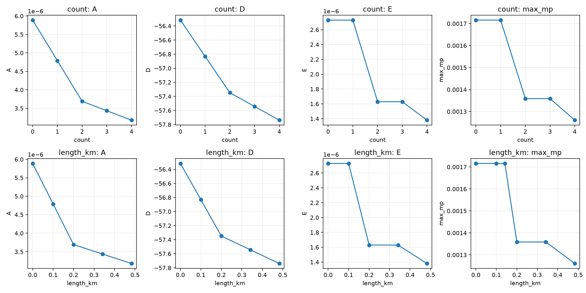

# 观测优化 Pareto 前沿

第 13 节基准网增加 4 条候选距离；保持原算例和黄金期望值。
成本分别为新增观测数、边长之和（km）；不计既有观测成本。
ε-预算扫描覆盖全部可达成本，精确求解后删除支配解。
A=trace(Cx)，D=log det(Cx)，E=最大特征值，max_mp=最大点位中误差（m）；均越小越好。
完整性仅针对当前小规模候选集，不包含大规模 MICP。

## count / A

| 成本 | 精度目标 | 新增观测数 | 选中观测 |
|---:|---:|---:|---|
| 0 | 5.8898869567e-06 | 0 | — |
| 1 | 4.79071155992e-06 | 1 | AC |
| 2 | 3.6915365144e-06 | 2 | AC; BD |
| 3 | 3.43534092129e-06 | 3 | AC; AD; BD |
| 4 | 3.17914462998e-06 | 4 | AC; AD; BC; BD |

## count / D

| 成本 | 精度目标 | 新增观测数 | 选中观测 |
|---:|---:|---:|---|
| 0 | -56.3161643143 | 0 | — |
| 1 | -56.8318527334 | 1 | AC |
| 2 | -57.3475411158 | 2 | AC; BD |
| 3 | -57.5427742337 | 3 | AC; AD; BD |
| 4 | -57.7380067743 | 4 | AC; AD; BC; BD |

## count / E

| 成本 | 精度目标 | 新增观测数 | 选中观测 |
|---:|---:|---:|---|
| 0 | 2.72978469339e-06 | 0 | — |
| 1 | 2.72825525288e-06 | 1 | BD |
| 2 | 1.62970502197e-06 | 2 | AC; BD |
| 3 | 1.6290934707e-06 | 3 | AC; BC; BD |
| 4 | 1.38076585757e-06 | 4 | AC; AD; BC; BD |

## count / max_mp

| 成本 | 精度目标 | 新增观测数 | 选中观测 |
|---:|---:|---:|---|
| 0 | 0.00171608376204 | 0 | — |
| 1 | 0.00171608192016 | 1 | AD |
| 2 | 0.00135859054067 | 2 | AC; BD |
| 3 | 0.00135858713125 | 3 | AC; AD; BD |
| 4 | 0.00126078242175 | 4 | AC; AD; BC; BD |

## length_km / A

| 成本 | 精度目标 | 新增观测数 | 选中观测 |
|---:|---:|---:|---|
| 0 | 5.8898869567e-06 | 0 | — |
| 0.1 | 4.79071155992e-06 | 1 | AC |
| 0.2 | 3.6915365144e-06 | 2 | AC; BD |
| 0.341421356 | 3.43534092129e-06 | 3 | AC; AD; BD |
| 0.482842712 | 3.17914462998e-06 | 4 | AC; AD; BC; BD |

## length_km / D

| 成本 | 精度目标 | 新增观测数 | 选中观测 |
|---:|---:|---:|---|
| 0 | -56.3161643143 | 0 | — |
| 0.1 | -56.8318527334 | 1 | AC |
| 0.2 | -57.3475411158 | 2 | AC; BD |
| 0.341421356 | -57.5427742337 | 3 | AC; AD; BD |
| 0.482842712 | -57.7380067743 | 4 | AC; AD; BC; BD |

## length_km / E

| 成本 | 精度目标 | 新增观测数 | 选中观测 |
|---:|---:|---:|---|
| 0 | 2.72978469339e-06 | 0 | — |
| 0.1 | 2.72825525288e-06 | 1 | BD |
| 0.2 | 1.62970502197e-06 | 2 | AC; BD |
| 0.341421356 | 1.6290934707e-06 | 3 | AC; BC; BD |
| 0.482842712 | 1.38076585757e-06 | 4 | AC; AD; BC; BD |

## length_km / max_mp

| 成本 | 精度目标 | 新增观测数 | 选中观测 |
|---:|---:|---:|---|
| 0 | 0.00171608376204 | 0 | — |
| 0.1 | 0.00171608303071 | 1 | AC |
| 0.141421356 | 0.00171608192016 | 1 | AD |
| 0.2 | 0.00135859054067 | 2 | AC; BD |
| 0.341421356 | 0.00135858713125 | 3 | AC; AD; BD |
| 0.482842712 | 0.00126078242175 | 4 | AC; AD; BC; BD |
