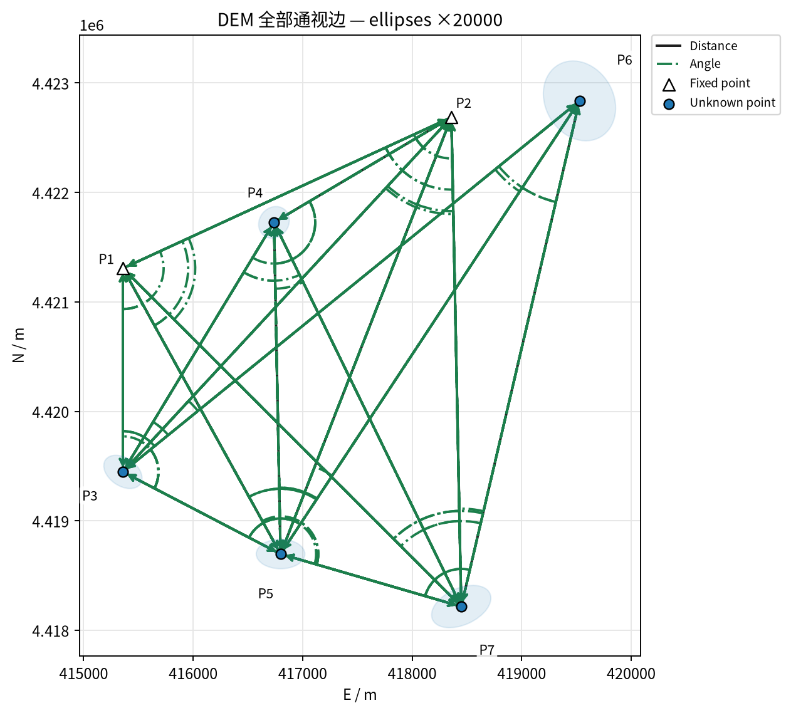
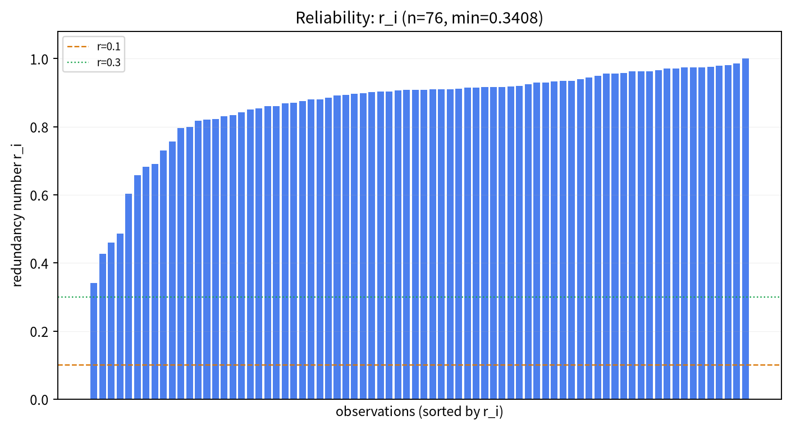
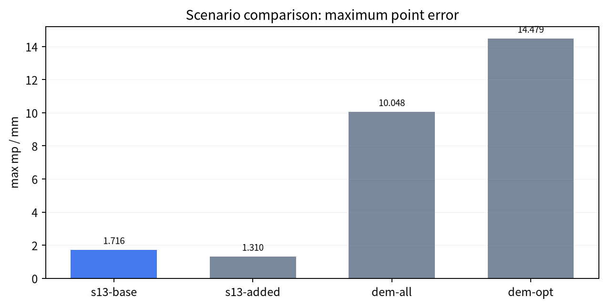
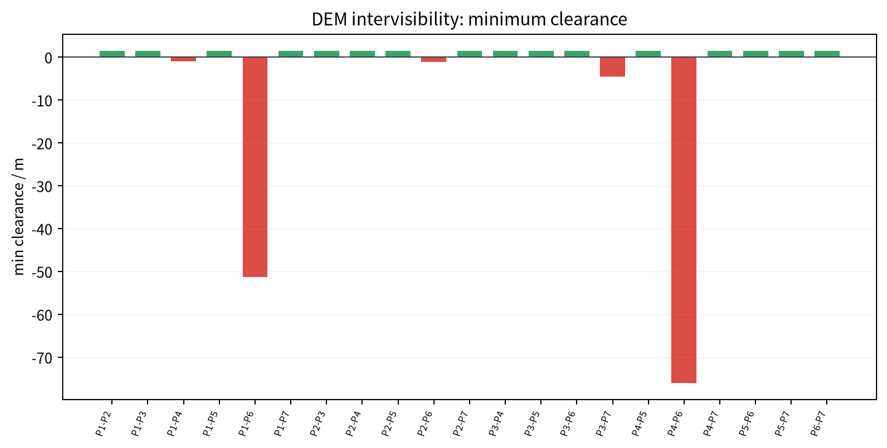

# 平面控制网设计报告

> 工程：**CTRLNET 演示工程**（`demo-project`）  
> 方案：**DEM 全部通视边**（`dem-all`，v1）  
> 快照：`976258ea48b1637c04c9967c1a72d67d70bdec40ad8c95173233e0444f07e68c`  
> 引擎：ctrlnet 0.1.0；生成时间：2026-11-04T14:00:06+00:00  
> 本报告为设计态/先验精度，不含实测残差与单位权方差估计。

## 1. 工程概况

- 工程名称：CTRLNET 演示工程；CRS：EPSG:32650；方案版本：v1；父方案：无。
- 方案点数 7（固定 2），观测数 76，参数数 10，秩 10，冗余数 66，条件数 6.866。
- DEM：data/sample/dem_sample.tif，EPSG:32650，[30.0, 30.0] m，来源 Copernicus GLO-30 DSM, AWS Open Data, (c) ESA，垂直基准 EGM2008 orthometric height。
- 通视参数：k=0.130，R=6371000 m，仪器高/目标高 1.50/1.50 m。
- 方案说明：7 个高地控制点，16 条通视距离 + 60 个通视水平角（全部通视边）。

## 2. 点与观测清单

### 2.1 控制点

| 点 | 角色 | E/m | N/m | 高程/m | σE/mm | σN/mm | mp/mm | a/mm | b/mm | 方位/° |
|---|---|---:|---:|---:|---:|---:|---:|---:|---:|---:|
| P1 | 固定 | 415358.435 | 4421306.613 | 944.88 | 0.000 | 0.000 | 0.000 | 0.000 | 0.000 | 0.00 |
| P2 | 固定 | 418358.435 | 4422686.613 | 852.60 | 0.000 | 0.000 | 0.000 | 0.000 | 0.000 | 0.00 |
| P3 | 待定 | 415358.435 | 4419446.613 | 834.46 | 3.573 | 3.105 | 4.733 | 9.677 | 6.371 | 124.66 |
| P4 | 待定 | 416738.435 | 4421726.613 | 773.55 | 2.869 | 2.958 | 4.120 | 7.592 | 6.640 | 38.35 |
| P5 | 待定 | 416798.435 | 4418696.613 | 747.88 | 4.535 | 2.751 | 5.304 | 11.102 | 6.733 | 90.19 |
| P6 | 待定 | 419528.435 | 4422836.613 | 642.34 | 6.742 | 7.451 | 10.048 | 19.083 | 15.517 | 149.62 |
| P7 | 待定 | 418448.435 | 4418216.613 | 638.79 | 5.533 | 3.948 | 6.797 | 14.388 | 8.353 | 65.50 |

### 2.2 观测清单

| # | 类型 | 观测 | 先验精度 | 观测值 | r_i |
|---:|---|---|---|---:|---:|
| 1 | 距离 | P1 – P2 | a=2.000 mm, b=2.00 ppm | 3302.1811 m | 1.0000 |
| 2 | 距离 | P1 – P3 | a=2.000 mm, b=2.00 ppm | 1860.0000 m | 0.4596 |
| 3 | 距离 | P1 – P5 | a=2.000 mm, b=2.00 ppm | 2980.8891 m | 0.7310 |
| 4 | 距离 | P1 – P7 | a=2.000 mm, b=2.00 ppm | 4369.9199 m | 0.8202 |
| 5 | 距离 | P2 – P3 | a=2.000 mm, b=2.00 ppm | 4415.6087 m | 0.9152 |
| 6 | 距离 | P2 – P4 | a=2.000 mm, b=2.00 ppm | 1883.0826 m | 0.4869 |
| 7 | 距离 | P2 – P5 | a=2.000 mm, b=2.00 ppm | 4284.1218 m | 0.8804 |
| 8 | 距离 | P2 – P7 | a=2.000 mm, b=2.00 ppm | 4470.9059 m | 0.8184 |
| 9 | 距离 | P3 – P4 | a=2.000 mm, b=2.00 ppm | 2665.1079 m | 0.6816 |
| 10 | 距离 | P3 – P5 | a=2.000 mm, b=2.00 ppm | 1623.6071 m | 0.4269 |
| 11 | 距离 | P3 – P6 | a=2.000 mm, b=2.00 ppm | 5374.1046 m | 0.6911 |
| 12 | 距离 | P4 – P5 | a=2.000 mm, b=2.00 ppm | 3030.5940 m | 0.7562 |
| 13 | 距离 | P4 – P7 | a=2.000 mm, b=2.00 ppm | 3904.3822 m | 0.7991 |
| 14 | 距离 | P5 – P6 | a=2.000 mm, b=2.00 ppm | 4959.0826 m | 0.6569 |
| 15 | 距离 | P5 – P7 | a=2.000 mm, b=2.00 ppm | 1718.4004 m | 0.3408 |
| 16 | 距离 | P6 – P7 | a=2.000 mm, b=2.00 ppm | 4744.5548 m | 0.6035 |
| 17 | 水平角 | ∠P2-P1-P7 | σ=1.00″ | 69.702430° | 0.9293 |
| 18 | 水平角 | ∠P2-P1-P5 | σ=1.00″ | 85.815848° | 0.9162 |
| 19 | 水平角 | ∠P2-P1-P3 | σ=1.00″ | 114.702430° | 0.8430 |
| 20 | 水平角 | ∠P7-P1-P5 | σ=1.00″ | 16.113418° | 0.9746 |
| 21 | 水平角 | ∠P7-P1-P3 | σ=1.00″ | 45.000000° | 0.9102 |
| 22 | 水平角 | ∠P5-P1-P3 | σ=1.00″ | 28.886582° | 0.9335 |
| 23 | 水平角 | ∠P5-P2-P3 | σ=1.00″ | 21.443024° | 0.9794 |
| 24 | 水平角 | ∠P5-P2-P4 | σ=1.00″ | 37.994955° | 0.9177 |
| 25 | 水平角 | ∠P5-P2-P1 | σ=1.00″ | 43.943192° | 0.9562 |
| 26 | 水平角 | ∠P5-P2-P7 | σ=1.00″ | -22.507828° | 0.9742 |
| 27 | 水平角 | ∠P3-P2-P4 | σ=1.00″ | 16.551930° | 0.9240 |
| 28 | 水平角 | ∠P3-P2-P1 | σ=1.00″ | 22.500168° | 0.9663 |
| 29 | 水平角 | ∠P3-P2-P7 | σ=1.00″ | -43.950852° | 0.9585 |
| 30 | 水平角 | ∠P4-P2-P1 | σ=1.00″ | 5.948238° | 0.9082 |
| 31 | 水平角 | ∠P4-P2-P7 | σ=1.00″ | -60.502782° | 0.8933 |
| 32 | 水平角 | ∠P1-P2-P7 | σ=1.00″ | -66.451020° | 0.9341 |
| 33 | 水平角 | ∠P1-P3-P4 | σ=1.00″ | 31.184975° | 0.9161 |
| 34 | 水平角 | ∠P1-P3-P2 | σ=1.00″ | 42.797402° | 0.9355 |
| 35 | 水平角 | ∠P1-P3-P6 | σ=1.00″ | 50.890626° | 0.8748 |
| 36 | 水平角 | ∠P1-P3-P5 | σ=1.00″ | 117.512003° | 0.8312 |
| 37 | 水平角 | ∠P4-P3-P2 | σ=1.00″ | 11.612427° | 0.9624 |
| 38 | 水平角 | ∠P4-P3-P6 | σ=1.00″ | 19.705652° | 0.8985 |
| 39 | 水平角 | ∠P4-P3-P5 | σ=1.00″ | 86.327028° | 0.8804 |
| 40 | 水平角 | ∠P2-P3-P6 | σ=1.00″ | 8.093225° | 0.9158 |
| 41 | 水平角 | ∠P2-P3-P5 | σ=1.00″ | 74.714601° | 0.9104 |
| 42 | 水平角 | ∠P6-P3-P5 | σ=1.00″ | 66.621376° | 0.8846 |
| 43 | 水平角 | ∠P3-P4-P2 | σ=1.00″ | -151.835643° | 0.7962 |
| 44 | 水平角 | ∠P3-P4-P7 | σ=1.00″ | -57.159369° | 0.9150 |
| 45 | 水平角 | ∠P3-P4-P5 | σ=1.00″ | -32.319396° | 0.9453 |
| 46 | 水平角 | ∠P2-P4-P7 | σ=1.00″ | 94.676274° | 0.8544 |
| 47 | 水平角 | ∠P2-P4-P5 | σ=1.00″ | 119.516246° | 0.8347 |
| 48 | 水平角 | ∠P7-P4-P5 | σ=1.00″ | 24.839972° | 0.9630 |
| 49 | 水平角 | ∠P3-P5-P1 | σ=1.00″ | 33.601416° | 0.9291 |
| 50 | 水平角 | ∠P3-P5-P4 | σ=1.00″ | 61.353576° | 0.9021 |
| 51 | 水平角 | ∠P3-P5-P2 | σ=1.00″ | 83.842375° | 0.9063 |
| 52 | 水平角 | ∠P3-P5-P6 | σ=1.00″ | 95.889666° | 0.8611 |
| 53 | 水平角 | ∠P3-P5-P7 | σ=1.00″ | 168.708191° | 0.8229 |
| 54 | 水平角 | ∠P1-P5-P4 | σ=1.00″ | 27.752160° | 0.9554 |
| 55 | 水平角 | ∠P1-P5-P2 | σ=1.00″ | 50.240959° | 0.9753 |
| 56 | 水平角 | ∠P1-P5-P6 | σ=1.00″ | 62.288250° | 0.9037 |
| 57 | 水平角 | ∠P1-P5-P7 | σ=1.00″ | 135.106775° | 0.8699 |
| 58 | 水平角 | ∠P4-P5-P2 | σ=1.00″ | 22.488799° | 0.9630 |
| 59 | 水平角 | ∠P4-P5-P6 | σ=1.00″ | 34.536090° | 0.8971 |
| 60 | 水平角 | ∠P4-P5-P7 | σ=1.00″ | 107.354615° | 0.8688 |
| 61 | 水平角 | ∠P2-P5-P6 | σ=1.00″ | 12.047291° | 0.9085 |
| 62 | 水平角 | ∠P2-P5-P7 | σ=1.00″ | 84.865816° | 0.8925 |
| 63 | 水平角 | ∠P6-P5-P7 | σ=1.00″ | 72.818525° | 0.8607 |
| 64 | 水平角 | ∠P7-P6-P5 | σ=1.00″ | 20.244126° | 0.9737 |
| 65 | 水平角 | ∠P7-P6-P3 | σ=1.00″ | 37.733084° | 0.9503 |
| 66 | 水平角 | ∠P5-P6-P3 | σ=1.00″ | 17.488958° | 0.9816 |
| 67 | 水平角 | ∠P5-P7-P1 | σ=1.00″ | 28.779806° | 0.9392 |
| 68 | 水平角 | ∠P5-P7-P4 | σ=1.00″ | 47.805412° | 0.9206 |
| 69 | 水平角 | ∠P5-P7-P2 | σ=1.00″ | 72.626356° | 0.9084 |
| 70 | 水平角 | ∠P5-P7-P6 | σ=1.00″ | 86.937349° | 0.8513 |
| 71 | 水平角 | ∠P1-P7-P4 | σ=1.00″ | 19.025606° | 0.9715 |
| 72 | 水平角 | ∠P1-P7-P2 | σ=1.00″ | 43.846550° | 0.9858 |
| 73 | 水平角 | ∠P1-P7-P6 | σ=1.00″ | 58.157543° | 0.9095 |
| 74 | 水平角 | ∠P4-P7-P2 | σ=1.00″ | 24.820944° | 0.9708 |
| 75 | 水平角 | ∠P4-P7-P6 | σ=1.00″ | 39.131937° | 0.9037 |
| 76 | 水平角 | ∠P2-P7-P6 | σ=1.00″ | 14.310993° | 0.9124 |

## 3. 先验精度模型

- 距离：`σ_s = sqrt(a² + (b·10⁻⁶·s)²)`，单位 m；默认 a=2 mm、b=2 ppm。
- 角度/方向：按角秒输入，内部转为弧度；默认 1.0″。
- 随机模型：对角权阵，设计态 `σ0=1`；`Cx=(AᵀQl⁻¹A)⁺`，固定点协方差为 0。
- 置信水平：0.950；95% 二维椭圆系数 `k=sqrt(-2ln0.05)=2.447747`。

## 4. 基准

- 基准类型：fixed（固定基准（Point.fixed=True 的坐标从参数中剔除））。
- 固定点：P1、P2。
- 参数顺序：E_P3、N_P3、E_P4、N_P4、E_P5、N_P5、E_P6、N_P6、E_P7、N_P7。

## 5. 点位精度与误差椭圆

| 点 | 角色 | E/m | N/m | 高程/m | σE/mm | σN/mm | mp/mm | a/mm | b/mm | 方位/° |
|---|---|---:|---:|---:|---:|---:|---:|---:|---:|---:|
| P1 | 固定 | 415358.435 | 4421306.613 | 944.88 | 0.000 | 0.000 | 0.000 | 0.000 | 0.000 | 0.00 |
| P2 | 固定 | 418358.435 | 4422686.613 | 852.60 | 0.000 | 0.000 | 0.000 | 0.000 | 0.000 | 0.00 |
| P3 | 待定 | 415358.435 | 4419446.613 | 834.46 | 3.573 | 3.105 | 4.733 | 9.677 | 6.371 | 124.66 |
| P4 | 待定 | 416738.435 | 4421726.613 | 773.55 | 2.869 | 2.958 | 4.120 | 7.592 | 6.640 | 38.35 |
| P5 | 待定 | 416798.435 | 4418696.613 | 747.88 | 4.535 | 2.751 | 5.304 | 11.102 | 6.733 | 90.19 |
| P6 | 待定 | 419528.435 | 4422836.613 | 642.34 | 6.742 | 7.451 | 10.048 | 19.083 | 15.517 | 149.62 |
| P7 | 待定 | 418448.435 | 4418216.613 | 638.79 | 5.533 | 3.948 | 6.797 | 14.388 | 8.353 | 65.50 |

最弱点：P6；最大点位中误差 10.048 mm。

## 6. 边相对精度

| 边 | 边长/m | σs/mm | 相对精度 |
|---|---:|---:|---:|
| P1P2 | 3302.181 | 0.000 | 1:∞ |
| P1P3 | 1860.000 | 3.105 | 1:599093 |
| P1P5 | 2980.889 | 3.262 | 1:913945 |
| P1P7 | 4369.920 | 3.802 | 1:1149435 |
| P2P3 | 4415.609 | 2.637 | 1:1674640 |
| P2P4 | 1883.083 | 3.054 | 1:616501 |
| P2P5 | 4284.122 | 3.043 | 1:1407810 |
| P2P7 | 4470.906 | 3.904 | 1:1145114 |
| P3P4 | 2665.108 | 3.213 | 1:829574 |
| P3P5 | 1623.607 | 2.887 | 1:562344 |
| P3P6 | 5374.105 | 6.076 | 1:884419 |
| P4P5 | 3030.594 | 3.152 | 1:961562 |
| P4P7 | 3904.382 | 3.613 | 1:1080609 |
| P5P6 | 4959.083 | 5.926 | 1:836807 |
| P5P7 | 1718.400 | 3.228 | 1:532277 |
| P6P7 | 4744.555 | 6.106 | 1:776999 |

最弱边：P5P7；最弱相对精度 1:532277。

## 7. 可靠性（r_i / MDB / 外部）

- λ0=7.849000，α=0.050，power=0.80；Σr_i=66.000000，期望冗余数=66。
- min r_i=0.3408；max MDB=3.140″；外部可靠性最大分量=12.390 mm。

| 观测 | 类型 | r_i | MDB | 外部最大影响/mm | 影响点 |
|---|---|---:|---:|---:|---|
| P1P2 | 距离 | 1.0000 | 19.333 mm | 0.000 | — |
| P1P3 | 距离 | 0.4596 | 17.453 mm | 9.431 | P3 |
| P1P5 | 距离 | 0.7310 | 20.606 mm | 5.198 | P5 |
| P1P7 | 距离 | 0.8202 | 27.735 mm | 5.359 | P7 |
| P2P3 | 距离 | 0.9152 | 26.517 mm | 2.035 | P3 |
| P2P4 | 距离 | 0.4869 | 17.121 mm | 7.194 | P4 |
| P2P5 | 距离 | 0.8804 | 26.271 mm | 3.875 | P7 |
| P2P7 | 距离 | 0.8184 | 28.375 mm | 5.208 | P7 |
| P3P4 | 距离 | 0.6816 | 19.320 mm | 3.291 | P4 |
| P3P5 | 距离 | 0.4269 | 16.354 mm | 5.422 | P5 |
| P3P6 | 距离 | 0.6911 | 36.844 mm | 8.717 | P6 |
| P4P5 | 距离 | 0.7562 | 20.564 mm | 2.885 | P6 |
| P4P7 | 距离 | 0.7991 | 25.263 mm | 3.510 | P7 |
| P5P6 | 距离 | 0.6569 | 34.973 mm | 9.625 | P6 |
| P5P7 | 距离 | 0.3408 | 19.082 mm | 9.178 | P7 |
| P6P7 | 距离 | 0.6035 | 34.972 mm | 12.390 | P6 |
| ∠P2-P1-P7 | 水平角 | 0.9293 | 2.906″ | 3.808 | P7 |
| ∠P2-P1-P5 | 水平角 | 0.9162 | 2.927″ | 3.643 | P7 |
| ∠P2-P1-P3 | 水平角 | 0.8430 | 3.051″ | 4.391 | P7 |
| ∠P7-P1-P5 | 水平角 | 0.9746 | 2.838″ | 0.862 | P5 |
| ∠P7-P1-P3 | 水平角 | 0.9102 | 2.937″ | 2.331 | P3 |
| ∠P5-P1-P3 | 水平角 | 0.9335 | 2.900″ | 1.827 | P3 |
| ∠P5-P2-P3 | 水平角 | 0.9794 | 2.831″ | 0.939 | P5 |
| ∠P5-P2-P4 | 水平角 | 0.9177 | 2.925″ | 1.744 | P4 |
| ∠P5-P2-P1 | 水平角 | 0.9562 | 2.865″ | 2.645 | P7 |
| ∠P5-P2-P7 | 水平角 | 0.9742 | 2.838″ | 1.466 | P7 |
| ∠P3-P2-P4 | 水平角 | 0.9240 | 2.915″ | 1.686 | P4 |
| ∠P3-P2-P1 | 水平角 | 0.9663 | 2.850″ | 1.786 | P3 |
| ∠P3-P2-P7 | 水平角 | 0.9585 | 2.862″ | 2.271 | P7 |
| ∠P4-P2-P1 | 水平角 | 0.9082 | 2.940″ | 2.243 | P4 |
| ∠P4-P2-P7 | 水平角 | 0.8933 | 2.964″ | 2.566 | P7 |
| ∠P1-P2-P7 | 水平角 | 0.9341 | 2.899″ | 4.116 | P7 |
| ∠P1-P3-P4 | 水平角 | 0.9161 | 2.927″ | 2.309 | P7 |
| ∠P1-P3-P2 | 水平角 | 0.9355 | 2.897″ | 2.452 | P7 |
| ∠P1-P3-P6 | 水平角 | 0.8748 | 2.995″ | 4.243 | P6 |
| ∠P1-P3-P5 | 水平角 | 0.8312 | 3.073″ | 2.649 | P3 |
| ∠P4-P3-P2 | 水平角 | 0.9624 | 2.856″ | 1.093 | P4 |
| ∠P4-P3-P6 | 水平角 | 0.8985 | 2.956″ | 4.513 | P6 |
| ∠P4-P3-P5 | 水平角 | 0.8804 | 2.986″ | 1.383 | P7 |
| ∠P2-P3-P6 | 水平角 | 0.9158 | 2.928″ | 5.192 | P6 |
| ∠P2-P3-P5 | 水平角 | 0.9104 | 2.936″ | 2.084 | P6 |
| ∠P6-P3-P5 | 水平角 | 0.8846 | 2.979″ | 3.169 | P6 |
| ∠P3-P4-P2 | 水平角 | 0.7962 | 3.140″ | 2.414 | P4 |
| ∠P3-P4-P7 | 水平角 | 0.9150 | 2.929″ | 2.483 | P7 |
| ∠P3-P4-P5 | 水平角 | 0.9453 | 2.881″ | 1.332 | P5 |
| ∠P2-P4-P7 | 水平角 | 0.8544 | 3.031″ | 3.050 | P7 |
| ∠P2-P4-P5 | 水平角 | 0.8347 | 3.066″ | 2.510 | P6 |
| ∠P7-P4-P5 | 水平角 | 0.9630 | 2.855″ | 1.258 | P7 |
| ∠P3-P5-P1 | 水平角 | 0.9291 | 2.907″ | 1.389 | P3 |
| ∠P3-P5-P4 | 水平角 | 0.9021 | 2.950″ | 1.100 | P4 |
| ∠P3-P5-P2 | 水平角 | 0.9063 | 2.943″ | 1.691 | P6 |
| ∠P3-P5-P6 | 水平角 | 0.8611 | 3.019″ | 4.152 | P6 |
| ∠P3-P5-P7 | 水平角 | 0.8229 | 3.088″ | 1.235 | P5 |
| ∠P1-P5-P4 | 水平角 | 0.9554 | 2.866″ | 1.546 | P4 |
| ∠P1-P5-P2 | 水平角 | 0.9753 | 2.837″ | 1.614 | P6 |
| ∠P1-P5-P6 | 水平角 | 0.9037 | 2.947″ | 5.020 | P6 |
| ∠P1-P5-P7 | 水平角 | 0.8699 | 3.004″ | 1.240 | P5 |
| ∠P4-P5-P2 | 水平角 | 0.9630 | 2.855″ | 1.287 | P4 |
| ∠P4-P5-P6 | 水平角 | 0.8971 | 2.958″ | 4.584 | P6 |
| ∠P4-P5-P7 | 水平角 | 0.8688 | 3.006″ | 1.793 | P7 |
| ∠P2-P5-P6 | 水平角 | 0.9085 | 2.939″ | 5.195 | P6 |
| ∠P2-P5-P7 | 水平角 | 0.8925 | 2.966″ | 2.446 | P7 |
| ∠P6-P5-P7 | 水平角 | 0.8607 | 3.020″ | 3.897 | P6 |
| ∠P7-P6-P5 | 水平角 | 0.9737 | 2.839″ | 1.290 | P6 |
| ∠P7-P6-P3 | 水平角 | 0.9503 | 2.874″ | 1.962 | P6 |
| ∠P5-P6-P3 | 水平角 | 0.9816 | 2.828″ | 1.007 | P6 |
| ∠P5-P7-P1 | 水平角 | 0.9392 | 2.891″ | 0.971 | P5 |
| ∠P5-P7-P4 | 水平角 | 0.9206 | 2.920″ | 1.148 | P7 |
| ∠P5-P7-P2 | 水平角 | 0.9084 | 2.940″ | 1.921 | P7 |
| ∠P5-P7-P6 | 水平角 | 0.8513 | 3.036″ | 4.578 | P6 |
| ∠P1-P7-P4 | 水平角 | 0.9715 | 2.842″ | 1.025 | P4 |
| ∠P1-P7-P2 | 水平角 | 0.9858 | 2.822″ | 1.116 | P7 |
| ∠P1-P7-P6 | 水平角 | 0.9095 | 2.938″ | 5.281 | P6 |
| ∠P4-P7-P2 | 水平角 | 0.9708 | 2.843″ | 1.094 | P4 |
| ∠P4-P7-P6 | 水平角 | 0.9037 | 2.947″ | 5.000 | P6 |
| ∠P2-P7-P6 | 水平角 | 0.9124 | 2.933″ | 5.721 | P6 |

## 8. 方案对比

| 方案 | 名称 | 版本 | 父方案 | 观测数 | max mp/mm | min r_i | max MDB/″ | 最弱边相对精度 |
|---|---|---|---|---:|---:|---:|---:|---:|
| s13-base | 第 13 节基准方案 | v1 | — | 7 | 1.716 | 0.0692 | 10.65 | 1:60565 |
| s13-added | 第 13 节增补方案 | v2 | s13-base | 8 | 1.310 | 0.0408 | 13.86 | 1:81608 |
| dem-all | DEM 全部通视边 | v1 | — | 76 | 10.048 | 0.3408 | 3.14 | 1:532277 |
| dem-opt | DEM 优化方案（预算 12） | v2 | dem-all | 25 | 14.479 | 0.0883 | 3.54 | 1:445875 |

- s13-base → s13-added：最大 mp 1.716 → 1.310 mm（-0.406）；观测数 7 → 8；min r_i 0.0692 → 0.0408；max MDB 10.65″ → 13.86″。
- dem-all → dem-opt：最大 mp 10.048 → 14.479 mm（+4.431）；观测数 76 → 25；min r_i 0.3408 → 0.0883；max MDB 3.14″ → 3.54″。

> 注意：不同点集/基准的方案之间只做指标展示，不应当直接比较绝对精度；父子方案对才具有可比性。

## 9. 优化建议

- 最弱点为 P6，建议优先在该点周围增加距离/角度检核，或提高其连接边数量。
- 最弱边为 P5P7，可增加一条跨越该边的距离观测，或改用更高精度测距设备。
- 外部可靠性最大影响 12.39 mm，未检出粗差可能显著影响点位；建议对该观测实施重复观测或独立检核。
- 与父方案相比，s13-added：最大 mp 1.716 → 1.310 mm（-0.406）；观测数 7 → 8；min r_i 0.0692 → 0.0408；max MDB 10.65″ → 13.86″。
- 与父方案相比，dem-opt：最大 mp 10.048 → 14.479 mm（+4.431）；观测数 76 → 25；min r_i 0.3408 → 0.0883；max MDB 3.14″ → 3.54″。
- 以上为设计态先验建议；施工前应结合控制点稳定性、仪器检校与现场通视条件复核。

## 10. 通视结果

本方案共 21 对点，通视 16 对，遮挡/临界 5 对。

| 点对 | 状态 | 平距/m | 最小净空/m | 最小位置/m | 采样点 |
|---|---|---:|---:|---:|---:|
| P1–P2 | 通视 | 3302.2 | 1.50 | 0.0 | 332 |
| P1–P3 | 通视 | 1860.0 | 1.50 | 0.0 | 187 |
| P1–P4 | 遮挡 | 1442.5 | -0.91 | 1412.7 | 146 |
| P1–P5 | 通视 | 2980.9 | 1.50 | 0.0 | 300 |
| P1–P6 | 遮挡 | 4441.8 | -51.31 | 2874.7 | 446 |
| P1–P7 | 通视 | 4369.9 | 1.50 | 0.0 | 438 |
| P2–P3 | 通视 | 4415.6 | 1.50 | 0.0 | 443 |
| P2–P4 | 通视 | 1883.1 | 1.50 | 0.0 | 190 |
| P2–P5 | 通视 | 4284.1 | 1.50 | 0.0 | 430 |
| P2–P6 | 遮挡 | 1179.6 | -1.05 | 30.0 | 119 |
| P2–P7 | 通视 | 4470.9 | 1.50 | 0.0 | 449 |
| P3–P4 | 通视 | 2665.1 | 1.50 | 0.0 | 268 |
| P3–P5 | 通视 | 1623.6 | 1.50 | 0.0 | 164 |
| P3–P6 | 通视 | 5374.1 | 1.50 | 0.0 | 539 |
| P3–P7 | 遮挡 | 3325.8 | -4.52 | 1288.4 | 334 |
| P4–P5 | 通视 | 3030.6 | 1.50 | 0.0 | 305 |
| P4–P6 | 遮挡 | 3002.7 | -75.97 | 1436.5 | 302 |
| P4–P7 | 通视 | 3904.4 | 1.50 | 0.0 | 392 |
| P5–P6 | 通视 | 4959.1 | 1.50 | 0.0 | 497 |
| P5–P7 | 通视 | 1718.4 | 1.50 | 0.0 | 173 |
| P6–P7 | 通视 | 4744.6 | 1.50 | 0.0 | 476 |

## 11. 图表



*图：网图与 95% 误差椭圆*



*图：可靠性 r_i*



*图：方案对比（最大点位中误差）*



*图：通视最小净空*

## 12. 复现与数据版本

```bash
.venv/bin/python -m ctrlnet.report --project /workspace/ctrlnet-design/data/sample/demo_project.sqlite --scenario dem-all --out outputs/report
```

- 快照哈希：`976258ea48b1637c04c9967c1a72d67d70bdec40ad8c95173233e0444f07e68c`；快照 ID：`snap-976258ea48b1637c`。
- 引擎版本：ctrlnet 0.1.0；schema 2.0。
- 结果按 `input_hash` 缓存在 `data/sample/demo_project.sqlite` 的 `results` 表。
